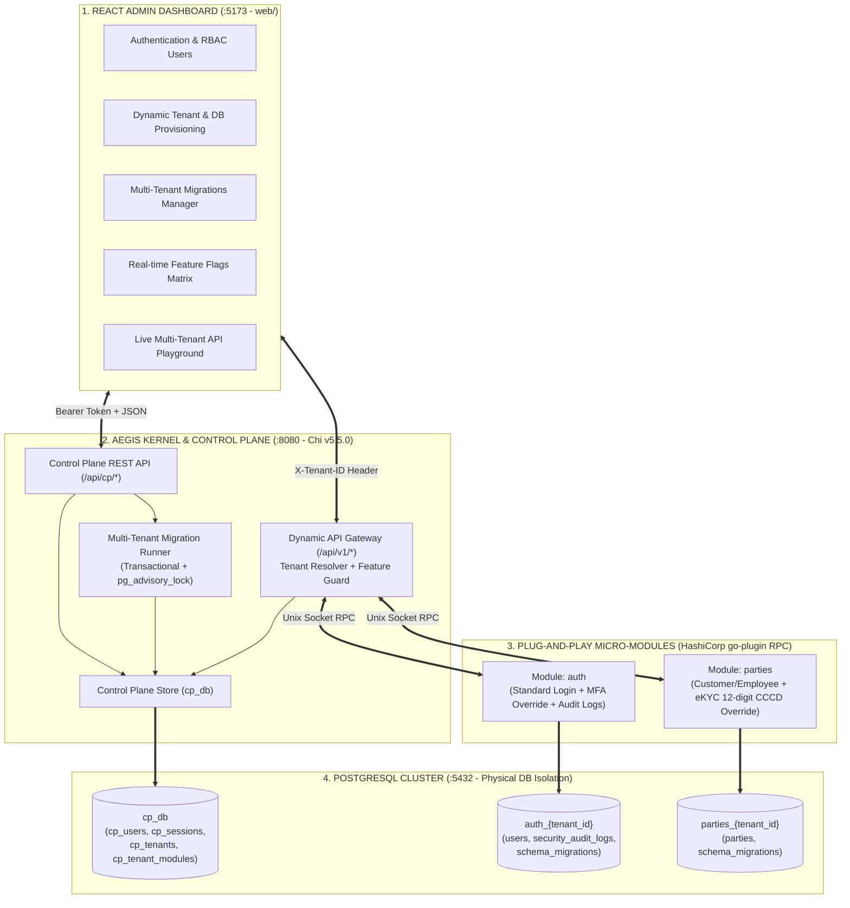

# 🛡️ AegisKernel

> **Dynamic Multi-Tenant Micro-Kernel, Control Plane & Plug-and-Play Architecture in Go**  
> Repository: [github.com/dudangphuoc/AegisKernel](https://github.com/dudangphuoc/AegisKernel)

**AegisKernel** là nền tảng kiến trúc **Micro-Kernel đa khách hàng (Multi-Tenant)** kết hợp **Clean Architecture + CQRS**, được thiết kế với mục tiêu cô lập tuyệt đối ở cả hai tầng: **Process Isolation** (các module chạy thành tiến trình độc lập qua `hashicorp/go-plugin`) và **Physical Database Isolation** (mỗi Tenant sở hữu các cơ sở dữ liệu PostgreSQL vật lý riêng biệt, được cấp phát tự động 100% qua Control Plane).

---

## ✨ Điểm Nổi Bật Cốt Lõi (Key Highlights)

1. **Zero Hardcode & Dynamic Tenant Provisioning:**
   - Không sử dụng file cấu hình tĩnh (`config.json`) hay dữ liệu demo cố định.
   - Khi đăng ký một Tenant mới, Control Plane tự động sinh Connection String động, thực thi `CREATE DATABASE` vật lý (`auth_<tenant_id>`, `parties_<tenant_id>`), chạy toàn bộ SQL Migrations và khởi tạo tài khoản Admin đầu tiên cho Tenant đó.
2. **Clean Architecture + CQRS + Feature Override Dispatcher:**
   - Tách biệt hoàn toàn **Base Business** (`internal/business/command`, `internal/business/query`) và **Feature Extensions / Overrides** (`internal/features/`).
   - Cùng một bộ mã nguồn nhưng mỗi Tenant có thể kích hoạt các biến thể nghiệp vụ khác nhau theo thời gian thực (ví dụ: Standard Login vs MFA High Assurance; đăng ký CMND 9 số vs bắt buộc eKYC CCCD gắn chip 12 số).
3. **High-Performance HTTP Gateway (`go-chi/chi v5.5.0`):**
   - Tương thích 100% chuẩn `net/http` và `context.Context` của Go, zero external dependencies, tích hợp sẵn chuỗi middleware (`RequestID`, `RealIP`, `Recoverer`, `CORS`, `Tenant Detector`, `Feature Guard`).
4. **Multi-Tenant Database Migration Engine:**
   - Quản lý phiên bản schema (`schema_migrations`) cho $N \text{ Tenants} \times M \text{ Modules}$.
   - Hỗ trợ **Migrate Up**, **Rollback Down (-1 step)** theo từng Tenant (Canary Release) hoặc **Batch Migrate All Tenants** an toàn với `pg_advisory_lock` và SQL Transaction.
5. **React Control Plane Admin Dashboard (`web/`):**
   - Giao diện quản trị tập trung: Xác thực Bearer Token (`SUPER_ADMIN` / `OPERATOR`), Quản lý Users, Cấp phát & Thu hồi Tenants, Quản lý Schema Migrations, Bật/Tắt Feature Flags tức thì (Hot Reload) và Live Multi-Tenant API Playground.

---

## 🏛️ Sơ Đồ Kiến Trúc Tổng Thể



---

## 📂 Cấu Trúc Thư Mục

```text
AegisKernel/
├── core/
│   ├── contract/       # Giao ước RPC & Structs dùng chung giữa Kernel và Modules
│   ├── controlplane/   # Quản trị Users, Tenants, Dynamic DB Provisioning & Migrator Service
│   ├── feature/        # Feature Flag Evaluator theo từng (Tenant x Module)
│   ├── gateway/        # API Gateway trên nền tảng Chi v5.5.0 & Dynamic OpenAPI 3.0
│   ├── loader/         # Bộ nạp binary Micro-Modules & Quản lý vòng đời tiến trình con
│   └── transport/      # HashiCorp go-plugin net/rpc adapter
├── launcher/           # Điểm khởi chạy trung tâm của AegisKernel (main.go)
├── sdk/
│   ├── cqrs/           # FeatureDispatcher kết nối Base Business & Feature Overrides
│   ├── migrator/       # Multi-Tenant SQL Migration Runner (Up / Down / Status)
│   ├── multitenant/    # Context Injector & Dynamic PostgreSQL Connection Pool Manager
│   └── app.go          # SDK khởi tạo Module & hỗ trợ chế độ F5 Standalone Debug
├── modules/
│   ├── auth/           # Module xác thực, MFA Security Override & Security Audit
│   └── parties/        # Module quản lý Nhân sự/Khách hàng, eKYC CCCD 12 số & Danh bạ
├── web/                # React 19 + TypeScript + Vite Control Plane Admin Dashboard
├── cookbooks/          # Tài liệu thiết kế kiến trúc & kế hoạch triển khai chi tiết
├── scripts/            # Script khởi tạo PostgreSQL container
├── docker-compose.yml  # Hạ tầng PostgreSQL 16 Alpine
└── Makefile            # Tập lệnh tự động hóa Build, Run, Test
```

---

## ⚡ Hướng Dẫn Khởi Động Nhanh (Quickstart)

### 1. Khởi động hạ tầng PostgreSQL
```bash
make docker-up
```
*(Khởi tạo container `golearn-postgres` ở cổng `5432` với database quản trị trung tâm `cp_db`).*

### 2. Biên dịch các Micro-Modules & Chạy AegisKernel
```bash
make run
```
- Lệnh này sẽ tự động biên dịch các module ra `bin/modules/auth` và `bin/modules/parties`, sau đó khởi chạy Kernel tại `http://localhost:8080`.
- Tài khoản Super Admin mặc định của Control Plane được khởi tạo tự động:
  - **Username:** `admin`
  - **Password:** `admin123`

### 3. Khởi chạy React Admin Dashboard
Mở một cửa sổ terminal mới:
```bash
cd web && npm install
make run-ui
```
Truy cập trình duyệt tại: **`http://localhost:5173`** và đăng nhập bằng `admin / admin123`.

---

## 🔄 Quy Trình Điều Chỉnh Schema Database (Multi-Tenant Migrations)

Khi cần thêm bảng hoặc cột mới cho một module (ví dụ `parties`):

1. **Tạo cặp file SQL Migration:**
   Thêm file `.up.sql` và `.down.sql` vào `modules/parties/migrations/` (ví dụ `0003_add_avatar.up.sql` và `0003_add_avatar.down.sql`).
2. **Đăng ký vào `scripts.go`:**
   Khai báo `//go:embed` trong `modules/parties/migrations/scripts.go` và thêm vào slice `GetPartiesMigrationScripts()`.
3. **Biên dịch lại:**
   ```bash
   make build-modules && make build-kernel
   ```
4. **Thực thi Migration:**
   - **Với Tenant mới:** Tự động áp dụng lên phiên bản mới nhất ngay khi đăng ký.
   - **Với các Tenant đang chạy:** Mở tab **Migrations** trên React Dashboard để bấm **Up** cho từng Tenant (Canary) hoặc **Đồng Bộ Batch Migrate Tất Cả DBs** (Zero-downtime). Hỗ trợ **Down** để rollback tức thì nếu cần.

---

## 🐞 Hướng Dẫn F5 Debug Độc Lập Từng Module

Dự án tích hợp sẵn chế độ **Standalone HTTP Debug** trong `sdk/app.go` và cấu hình `.vscode/launch.json` giúp bạn đặt Breakpoint trực tiếp trong IDE mà không bị phụ thuộc vào tiến trình cha `go-plugin`:

- **Debug Module Auth:** Chọn cấu hình **"Debug: Module Auth (Standalone HTTP)"** (chạy độc lập tại cổng `:8081`).
- **Debug Module Parties:** Chọn cấu hình **"Debug: Module Parties (Standalone HTTP)"** (chạy độc lập tại cổng `:8082`).

---

## 📊 Hiệu Năng Thực Tế (Benchmark)

Kết quả kiểm thử tải (Load Testing) trên kiến trúc **AegisKernel**:
- **Tổng số lượng Requests:** `239,910 requests`
- **Throughput:** `~2,002 Requests/second (RPS)`
- **Độ trễ trung bình (Avg Latency):** `43 ms` (`P90: 79 ms`, `P95: 93 ms`, `P99: 125 ms`)
- **Tỷ lệ lỗi (Error / Failure Rate):** `0.00%`
- **Tài nguyên tiêu thụ:** `Peak CPU: 68.9%` | `Peak Memory: 32.0%`

---

## 🧪 Kiểm Thử (Testing)

Chạy toàn bộ Unit & Integration Tests (kèm kiểm tra cô lập dữ liệu Multi-Tenant và Race Detector):
```bash
make test
```
