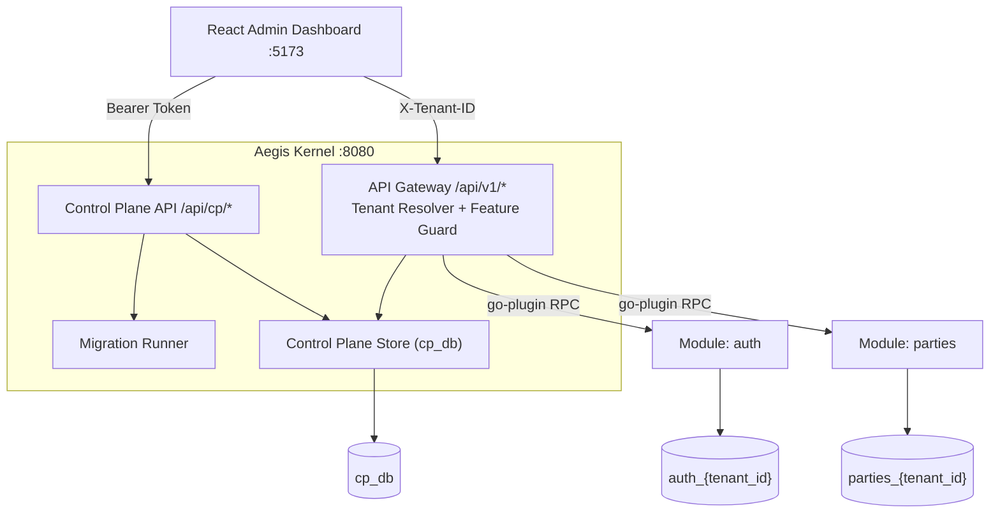

# 🛡️ AegisKernel

> Dynamic multi-tenant micro-kernel with a control plane and plug-and-play modules, written in Go.

**AegisKernel** combines **Clean Architecture + CQRS** with two layers of isolation: **process isolation** (modules run as separate processes via `hashicorp/go-plugin`) and **physical database isolation** (each tenant gets its own PostgreSQL databases, provisioned automatically by the Control Plane).

## ✨ Key Features

- **Dynamic tenant provisioning:** no static config. Registering a tenant creates its databases (`auth_<tenant_id>`, `parties_<tenant_id>`), runs migrations, and seeds its first admin.
- **CQRS + feature overrides:** base logic lives in `internal/business`, per-tenant variants in `internal/features` and are toggled at runtime (e.g. standard login vs. MFA).
- **HTTP gateway (`go-chi/chi`):** standard `net/http`, with middleware for request ID, real IP, recovery, CORS, tenant detection and feature guard.
- **Migration engine:** per-tenant Up/Down (canary) or batch migrate, safe via `pg_advisory_lock` and transactions.
- **React admin dashboard (`web/`):** users, tenants, migrations, feature flags (hot reload) and an API playground.

## 🏛️ Architecture



## 📂 Structure

```text
core/        contract, controlplane, feature, gateway, loader, transport
launcher/    kernel entry point (main.go)
sdk/         cqrs, migrator, multitenant, app.go (standalone debug)
modules/     auth, parties
web/         React 19 + TypeScript + Vite dashboard
cookbooks/   design docs
scripts/     PostgreSQL init
```

## ⚡ Quickstart

```bash
make docker-up          # PostgreSQL on :5432 (cp_db)
make run                # build modules + start kernel on :8080
cd web && npm install && make run-ui   # dashboard on :5173
```

Default login: `admin` / `admin123`.

## 🔄 Adding a Migration

1. Add `NNNN_name.up.sql` and `NNNN_name.down.sql` to `modules/<module>/migrations/`.
2. Embed and register them in that folder's `scripts.go`.
3. Rebuild: `make build-modules && make build-kernel`.
4. New tenants migrate automatically. For existing tenants, use the **Migrations** tab (Up per tenant, or batch).

## 🐞 Standalone Debugging

`sdk/app.go` supports standalone HTTP mode. Use the `.vscode/launch.json` configs: **Module Auth** (`:8081`) and **Module Parties** (`:8082`).

## 📊 Benchmark

~2,002 RPS over 239,910 requests · avg 43 ms (P99 125 ms) · 0% errors · peak CPU 68.9%.

## 🧪 Testing

```bash
make test
```
