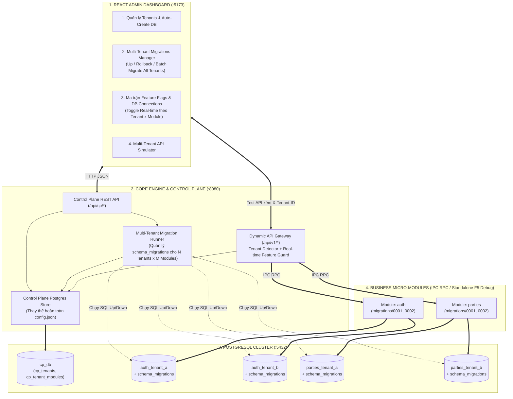

# Kế Hoạch Xây Dựng Control Plane (PostgreSQL + Multi-Tenant Migrations + React Admin Dashboard)

---

## 1. Mục Tiêu Cốt Lõi (Goal Description)

Chuyển đổi toàn bộ hệ thống từ cấu hình tĩnh ([config.json](file:///Users/raiden/Workspace/2026/go-learn/config.json)) và lưu trữ RAM cục bộ sang kiến trúc **Enterprise Control Plane + Data Plane** sử dụng **PostgreSQL 100%**, tích hợp **Multi-Tenant Database Migration Engine**, và quản trị trực tiếp qua **React Admin Dashboard**:

1. **Xóa bỏ `config.json` & In-Memory Store:** Toàn bộ cấu hình Tenants, Modules, Feature Flags, Connection Strings được lưu trữ và quản lý tập trung trong database PostgreSQL của Control Plane (`cp_db`).
2. **PostgreSQL Multi-Tenant thực tế:** Cả 2 module nghiệp vụ (`modules/auth` và `modules/parties`) sử dụng `ConnectionManager[*sql.DB]` kết nối trực tiếp tới các database PostgreSQL riêng biệt của từng Tenant (`auth_tenant_a`, `auth_tenant_b`, `parties_tenant_a`, `parties_tenant_b`).
3. **Quản lý Migrations cho nhiều Tenants (Multi-Tenant Migration Engine):**
   * Mỗi module (`auth`, `parties`) có bộ file SQL migrations được đánh số phiên bản (`0001_init...up.sql`, `0002_add_...up.sql` & `.down.sql`).
   * Mỗi Tenant Database có bảng `schema_migrations` lưu lịch sử các version đã chạy (`version`, `name`, `applied_at`, `execution_ms`).
   * Control Plane cung cấp bộ điều phối **Multi-Tenant Migrator** cho phép:
     * Kiểm tra trạng thái Schema Version của từng `(Tenant × Module)` (`Current Version`, `Latest Version`, `Pending Migrations`, trạng thái `UP_TO_DATE` hay `OUTDATED`).
     * Chạy **Migrate Up** (nâng cấp lên version mới nhất) hoặc **Rollback Down** (hạ 1 version) trong SQL Transaction cho **từng Tenant riêng lẻ** hoặc **Batch Migrate cho toàn bộ Tenants cùng lúc**.
     * Tự động tạo Database mới (`CREATE DATABASE`) và chạy миграции khởi tạo khi cấp phát Tenant mới.
4. **React Control Plane Dashboard (`web/`):** Giao diện quản trị trực quan gồm 4 phân hệ:
   * **Tenants & Provisioning:** Danh sách Tenants, tạo Tenant mới & tự động khởi tạo Postgres DB riêng.
   * **Multi-Tenant Migrations Manager:** Theo dõi version DB của từng Tenant, xem danh sách file SQL (`Applied` vs `Pending`), bấm nút **Migrate Up**, **Rollback Down**, hoặc **Migrate All Tenants**.
   * **Feature Flags & DB Matrix:** Bật / Tắt (Toggle) các cờ tính năng (`mfa_security`, `security_audit`, `ekyc_verification`, `employee_directory`) và đổi `ConnectionString` theo thời gian thực (Hot Reload).
   * **Multi-Tenant API Simulator:** Kiểm thử trực tiếp hành vi của `Tenant A` vs `Tenant B` ngay trên Dashboard.
5. **Hỗ trợ F5 Debug (Standalone Dev Mode):** Bổ sung chế độ chạy độc lập cho SDK để lập trình viên nhấn F5 Debug từng module trực tiếp trong IDE.

---

## 2. SUMMARY: Kiến Trúc Tổng Thể & Checklist (Người Dùng Xem)

### 2.1. Sơ đồ Kiến trúc Control Plane, Multi-Tenant Migrator & Data Plane



### 2.2. Checklist Đã Hoàn Thành (100% Done)

- [x] **Bước 1: Hạ tầng PostgreSQL Multi-Database (`docker-compose.yml` & Init SQL)**
  - [x] Cấu hình PostgreSQL container chỉ khởi tạo database `cp_db` của Control Plane (loại bỏ hoàn toàn mọi dữ liệu demo/seed cứng `tenant-a`, `tenant-b`).
  - [x] Cài đặt driver PostgreSQL (`github.com/lib/pq`) và `golang.org/x/crypto/bcrypt` vào `go.mod`.
  - [x] Xóa bỏ hoàn toàn file `config.json` thủ công.
- [x] **Bước 2: Xây dựng Multi-Tenant Migration Engine (`sdk/migrator` & SQL Migrations)**
  - [x] Tạo `sdk/migrator/runner.go`: Bộ thực thi SQL migrations hỗ trợ `Up`, `Down (Rollback 1 bước)`, `Status` trên bất kỳ `connectionString` nào của Tenant, sử dụng bảng `schema_migrations` và khóa `pg_advisory_lock` chống xung đột khi migrate đồng thời.
  - [x] Tạo bộ file SQL Migrations cho module `auth` (`modules/auth/migrations/`):
    - `0001_init_auth.up.sql` & `.down.sql` (Bảng `users`, `security_audit_logs`).
    - `0002_add_security_metadata.up.sql` & `.down.sql` (Thêm cột `last_login_at`, `security_tier` để kiểm nghiệm nâng cấp v1 → v2).
  - [x] Tạo bộ file SQL Migrations cho module `parties` (`modules/parties/migrations/`):
    - `0001_init_parties.up.sql` & `.down.sql` (Bảng `parties` lưu `Employee`, `Customer`, `Identity CMND/CCCD`).
    - `0002_add_tax_and_kyc_notes.up.sql` & `.down.sql` (Thêm cột `tax_code`, `kyc_notes` để kiểm nghiệm nâng cấp v1 → v2 và Rollback v2 → v1).
- [x] **Bước 3: Xây dựng Core Control Plane (`core/controlplane/`)**
  - [x] Tạo `core/controlplane/store.go`:
    - Quản lý người dùng Control Plane (`cp_users` băm bcrypt, `cp_sessions`).
    - Khởi tạo tài khoản Super Admin ban đầu: `admin / admin123`.
    - Sinh connection string động tự động (`BuildConnectionString`) dựa vào `CP_DATABASE_URL` (không hardcode).
    - Cấp phát Tenant tự động 100% (`ProvisionTenant`): Tự động `CREATE DATABASE` vật lý (`auth_{id}`, `parties_{id}`), tự động chạy toàn bộ migrations, tự động khởi tạo User Admin cho Tenant.
    - Xóa Tenant hoàn toàn (`DeleteTenant`): DROP physical databases và xóa metadata.
  - [x] Tạo `core/controlplane/migrator_service.go`: Điều phối chạy Migration cho 1 `(Tenant, Module)` hoặc chạy **Batch Migration** cho toàn bộ Tenants trên hệ thống.
  - [x] Tạo `core/controlplane/handler.go`: Cung cấp các RESTful API quản trị bảo vệ bởi Bearer Token Middleware (`authMiddleware`):
    - `POST /api/cp/auth/login` & `GET /api/cp/auth/me`
    - `GET /api/cp/users`, `POST /api/cp/users`, `DELETE /api/cp/users/{id}` (Quản trị User Control Plane)
    - `GET /api/cp/overview`
    - `GET /api/cp/tenants` & `POST /api/cp/tenants` & `DELETE /api/cp/tenants/{tenant_id}`
    - `PUT /api/cp/tenants/{tenant_id}/modules/{module_name}` (Bật/tắt Feature Flags & Connection String)
    - `GET /api/cp/migrations/status` (Xem trạng thái Schema Version của mọi Tenant)
    - `POST /api/cp/migrations/run` (Chạy `up` hoặc `down` cho 1 Tenant × Module)
    - `POST /api/cp/migrations/run-all` (Batch Migrate toàn bộ Tenants lên version mới nhất)
- [x] **Bước 4: Chuyển đổi Module `[auth]` và `[parties]` sang PostgreSQL 100% + Hỗ trợ F5 Debug**
  - [x] Chuyển đổi `auth` sang `postgres_auth_repo.go` (`ConnectionManager[*sql.DB]`).
  - [x] Chuyển đổi `parties` sang `postgres_party_repo.go` (`ConnectionManager[*sql.DB]`).
  - [x] Nâng cấp `sdk/app.go` hỗ trợ `STANDALONE_PORT` và tạo `.vscode/launch.json` để nhấn F5 Debug từng module độc lập.
- [x] **Bước 5: Xây dựng React Admin Dashboard (`web/`)**
  - [x] Màn hình Đăng nhập Control Plane (xác thực token Bearer).
  - [x] Phân hệ Quản trị Users Control Plane (xem danh sách, tạo mới Admin/Operator, xóa user).
  - [x] Phân hệ Quản lý Tenants: Cấp phát động (Tenant ID, Tên tổ chức, Gói cước, Tenant Admin credentials), xóa Tenant và thu hồi database. Không hardcode dữ liệu mẫu.
  - [x] Phân hệ Multi-Tenant Migrations Manager: Theo dõi version DB của từng Tenant, Migrate Up / Down / Batch Migrate All.
  - [x] Phân hệ Feature Flags: Real-time toggles per Tenant (`mfa_security`, `security_audit`, `ekyc_verification`, `employee_directory`).
  - [x] Phân hệ Live Multi-Tenant API Playground: Chọn Tenant động, kiểm thử Login (Standard vs MFA Override), Đăng ký đối tác (Standard CMND vs eKYC CCCD 12 số) và kiểm tra Database Isolation.
- [x] **Bước 6: Kiểm thử tích hợp End-to-End**
  - [x] Toàn bộ Go tests pass 100% (`go test -v ./...`).
  - [x] TypeScript & Vite build thành công (`npm --prefix web run build`).
  - [x] Đã kiểm thử trực tiếp qua cURL và xác minh hoạt động hoàn hảo.

---

## 3. DETAIL: Thiết Kế Chi Tiết Từng Hạng Mục (Dành Cho AI Thực Hiện)

### 3.1. Bộ điều phối Multi-Tenant Migrations (`sdk/migrator` & `core/controlplane`)

#### [NEW] `sdk/migrator/runner.go`
* Định nghĩa cấu trúc một bản Migration:
  ```go
  type MigrationScript struct {
      Version int    `json:"version"`
      Name    string `json:"name"`
      UpSQL   string `json:"-"`
      DownSQL string `json:"-"`
  }

  type AppliedMigration struct {
      Version     int       `json:"version"`
      Name        string    `json:"name"`
      AppliedAt   time.Time `json:"applied_at"`
      ExecutionMs int64     `json:"execution_ms"`
  }

  type TenantMigrationStatus struct {
      TenantID          string             `json:"tenant_id"`
      ModuleName        string             `json:"module_name"`
      ConnectionString  string             `json:"connection_string"`
      CurrentVersion    int                `json:"current_version"`
      LatestVersion     int                `json:"latest_version"`
      PendingCount      int                `json:"pending_count"`
      Status            string             `json:"status"` // UP_TO_DATE, PENDING_MIGRATIONS, ERROR
      AppliedMigrations []AppliedMigration `json:"applied_migrations"`
      PendingMigrations []string           `json:"pending_migrations"`
      ErrorMessage      string             `json:"error_message,omitempty"`
  }
  ```
* Cơ chế thực thi an toàn trên từng Tenant DB:
  1. Tự động đảm bảo bảng `schema_migrations` tồn tại trên DB của Tenant.
  2. Sử dụng **PostgreSQL Advisory Lock** (`SELECT pg_advisory_lock(hashtext('golearn_migration'))`) để đảm bảo nếu nhiều instance cùng chạy migration trên 1 Tenant DB thì không bao giờ bị đụng độ (Race Condition).
  3. Khi gọi `MigrateUp(ctx, db, scripts)`:
     * Lọc ra các script có `Version > CurrentVersion` theo thứ tự tăng dần.
     * Với mỗi script: Mở `tx, _ := db.BeginTx(ctx, nil)`, chạy `tx.ExecContext(ctx, script.UpSQL)`, ghi nhận vào `schema_migrations`, và `tx.Commit()`. Nếu có lỗi ở bất kỳ câu lệnh nào, tự động `tx.Rollback()` giữ nguyên tính toàn vẹn dữ liệu của Tenant.
  4. Khi gọi `RollbackDown(ctx, db, scripts)`:
     * Tìm version cao nhất hiện tại trong `schema_migrations`, chạy `script.DownSQL` trong Transaction và xóa dòng version đó khỏi `schema_migrations`.

---

### 3.2. Các File SQL Migrations theo từng Module

#### [NEW] `modules/auth/migrations/`
* `0001_init_auth.up.sql`:
  ```sql
  CREATE TABLE IF NOT EXISTS users (
      id VARCHAR(64) PRIMARY KEY,
      tenant_id VARCHAR(64) NOT NULL,
      username VARCHAR(128) NOT NULL UNIQUE,
      password VARCHAR(255) NOT NULL,
      role VARCHAR(64) NOT NULL DEFAULT 'TENANT_ADMIN',
      mfa_code VARCHAR(32) NOT NULL DEFAULT '654321',
      created_at TIMESTAMPTZ NOT NULL DEFAULT NOW()
  );

  CREATE TABLE IF NOT EXISTS security_audit_logs (
      id VARCHAR(64) PRIMARY KEY,
      tenant_id VARCHAR(64) NOT NULL,
      username VARCHAR(128) NOT NULL,
      action VARCHAR(128) NOT NULL,
      details TEXT NOT NULL,
      timestamp TIMESTAMPTZ NOT NULL DEFAULT NOW()
  );

  INSERT INTO users (id, tenant_id, username, password, role, mfa_code)
  VALUES ('USR-ADMIN-01', current_database(), 'admin', 'pass123', 'TENANT_ADMIN', '654321')
  ON CONFLICT (username) DO NOTHING;
  ```
* `0001_init_auth.down.sql`:
  ```sql
  DROP TABLE IF EXISTS security_audit_logs;
  DROP TABLE IF EXISTS users;
  ```
* `0002_add_security_metadata.up.sql`:
  ```sql
  ALTER TABLE users ADD COLUMN IF NOT EXISTS security_tier VARCHAR(64) NOT NULL DEFAULT 'STANDARD';
  ALTER TABLE security_audit_logs ADD COLUMN IF NOT EXISTS client_ip VARCHAR(64) NOT NULL DEFAULT '127.0.0.1';
  ```
* `0002_add_security_metadata.down.sql`:
  ```sql
  ALTER TABLE security_audit_logs DROP COLUMN IF EXISTS client_ip;
  ALTER TABLE users DROP COLUMN IF EXISTS security_tier;
  ```

#### [NEW] `modules/parties/migrations/`
* `0001_init_parties.up.sql`:
  ```sql
  CREATE TABLE IF NOT EXISTS parties (
      id VARCHAR(64) PRIMARY KEY,
      tenant_id VARCHAR(64) NOT NULL,
      party_type VARCHAR(32) NOT NULL,
      full_name VARCHAR(255) NOT NULL,
      email VARCHAR(255) NOT NULL,
      phone VARCHAR(64) NOT NULL,
      identity_type VARCHAR(32) NOT NULL,
      identity_number VARCHAR(64) NOT NULL UNIQUE,
      identity_issued_date VARCHAR(64) NOT NULL DEFAULT '',
      identity_issued_place VARCHAR(255) NOT NULL DEFAULT '',
      verification_status VARCHAR(64) NOT NULL,
      employee_profile JSONB,
      customer_profile JSONB,
      processed_by VARCHAR(128) NOT NULL,
      database_source TEXT NOT NULL,
      created_at TIMESTAMPTZ NOT NULL DEFAULT NOW()
  );
  ```
* `0001_init_parties.down.sql`:
  ```sql
  DROP TABLE IF EXISTS parties;
  ```
* `0002_add_party_tax_and_notes.up.sql`:
  ```sql
  ALTER TABLE parties ADD COLUMN IF NOT EXISTS tax_code VARCHAR(64) NOT NULL DEFAULT '';
  ALTER TABLE parties ADD COLUMN IF NOT EXISTS kyc_notes TEXT NOT NULL DEFAULT '';
  ```
* `0002_add_party_tax_and_notes.down.sql`:
  ```sql
  ALTER TABLE parties DROP COLUMN IF EXISTS kyc_notes;
  ALTER TABLE parties DROP COLUMN IF EXISTS tax_code;
  ```

---

### 3.3. Thành phần Core Control Plane (`core/controlplane/`)

#### [NEW] `core/controlplane/store.go`
* Lưu trữ cấu hình tập trung trong PostgreSQL `cp_db` (`cp_tenants`, `cp_tenant_modules`).
* Khi khởi tạo lần đầu:
  1. Tạo bảng `cp_tenants` và `cp_tenant_modules`.
  2. Seed `tenant-a` và `tenant-b` vào `cp_db`.
  3. Tự động đảm bảo các database `auth_tenant_a`, `auth_tenant_b`, `parties_tenant_a`, `parties_tenant_b` tồn tại trên PostgreSQL server và chạy Migration khởi tạo để hệ thống sẵn sàng hoạt động ngay lập tức.
* Khi tạo Tenant mới (`ProvisionTenant`):
  1. Tự động chạy `CREATE DATABASE auth_<tenant_id>` và `CREATE DATABASE parties_<tenant_id>`.
  2. Tự động chạy bộ SQL Migrations của cả 2 module `auth` và `parties` lên database vừa tạo!

#### [NEW] `core/controlplane/handler.go`
* Các API của Control Plane:
  * `GET /api/cp/tenants`: Danh sách Tenants & cấu hình từng Module.
  * `POST /api/cp/tenants`: Cấp phát Tenant mới + Auto-create DB + Auto-migrate.
  * `PUT /api/cp/tenants/{tenant_id}/modules/{module_name}`: Cập nhật nóng Feature Flags & Connection String.
  * `GET /api/cp/migrations/status`: Trả về danh sách `TenantMigrationStatus` cho toàn bộ `(Tenant × Module)` (version hiện tại, lịch sử `applied_migrations`, danh sách `pending_migrations`).
  * `POST /api/cp/migrations/run`: Nhận `{ "tenant_id": "tenant-a", "module_name": "parties", "action": "up" | "down" }` để nâng cấp hoặc rollback schema cho đúng Tenant đó.
  * `POST /api/cp/migrations/run-all`: Chạy Batch Migrate nâng cấp toàn bộ Tenants trên hệ thống lên version mới nhất.

---

### 3.4. Chuyển đổi Module `[auth]` & `[parties]` sang PostgreSQL 100% + F5 Debug

* **[DELETE]** `config.json`, `core/config/config.go`, `modules/auth/internal/adapter/storage/memory_repo.go`, `modules/parties/internal/adapter/storage/tenant_party_repo.go`.
* **[NEW]** `modules/auth/internal/adapter/storage/postgres_repo.go` & `modules/parties/internal/adapter/storage/postgres_party_repo.go`: Kết nối PostgreSQL thật qua `multitenant.ConnectionManager[*sql.DB]`.
* **[MODIFY]** `sdk/app.go` & **[NEW]** `.vscode/launch.json`: Hỗ trợ chạy trực tiếp HTTP Server khi debug F5 trong IDE (`STANDALONE_PORT`).

---

### 3.5. Xây dựng React Admin Dashboard (`web/`)

* **[NEW]** `web/` (React + TypeScript + Vite):
  * **Tab 1 — Tenants & Provisioning:** Quản lý danh sách Tenants, tạo mới Tenant kèm tự động cấp phát DB PostgreSQL.
  * **Tab 2 — Multi-Tenant Migrations Manager:**
    * Hiển thị bảng trạng thái Migration của mọi `(Tenant × Module)`: `Current Version` (ví dụ `v2`), `Latest Version` (`v2`), badge `UP_TO_DATE` hoặc `PENDING_MIGRATIONS`, danh sách lịch sử các bản migration đã chạy kèm thời gian thực thi (`ms`).
    * Nút **"Rollback (-1 Step)"** để hạ từ `v2` về `v1`, nút **"Migrate Up"** để nâng từ `v1` lên `v2` cho từng Tenant riêng biệt, và nút **"Migrate All Tenants"** để nâng cấp đồng loạt!
  * **Tab 3 — Feature Flags & DB Matrix:** Toggle Switch bật/tắt `mfa_security`, `security_audit`, `ekyc_verification`, `employee_directory` và đổi `ConnectionString` theo thời gian thực.
  * **Tab 4 — Multi-Tenant API Playground:** Giao diện test trực tiếp các API của `auth` và `parties` theo từng Tenant.
