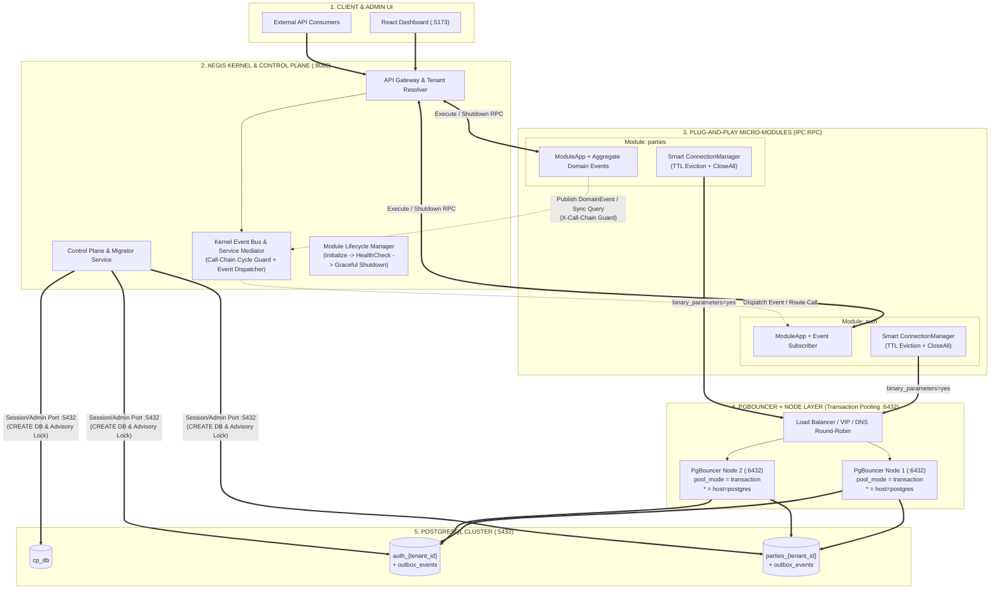

# Kế Hoạch [03]: Giao Tiếp Liên Module (IPC/EDA), Kiến Trúc PgBouncer × Node & Tái Thiết Lập Lifecycle Hệ Thống

---

## 1. Mục Tiêu Cốt Lõi (Goal Description)

Giải quyết triệt để các nút thắt kiến trúc khi mở rộng quy mô lớn (High-Scale Multi-Tenancy) liên quan đến **Database Connection Exhaustion**, **Resource/Process Lifecycle**, và **Inter-Module Communication (Chống Distributed Monolith / Spaghetti Calls)**:

1. **Chấm dứt kết nối trực tiếp tới PostgreSQL — Triển khai tầng `PgBouncer × Node`:**
   * Các Micro-Modules **tuyệt đối không kết nối trực tiếp** vào PostgreSQL (`:5432`).
   * Xây dựng tầng **PgBouncer Cluster (Multi-Node Connection Pooler)** đứng trước PostgreSQL với cấu hình **Wildcard Dynamic Databases (`* = host=postgres port=5432`)** và chế độ **`pool_mode = transaction`**.
   * Hỗ trợ tự động định tuyến cho mọi database `<module>_<tenant_id>` được cấp phát động mà không cần reload hay sửa file cấu hình PgBouncer thủ công.
   * Phân tách rõ kết nối:
     * **Data Plane (Modules):** Đi qua cụm `PgBouncer × Node` (`:6432`, Transaction Pooling).
     * **Control Plane DDL / Migrator:** Sử dụng kết nối quản trị để thực thi `CREATE/DROP DATABASE` và `pg_advisory_lock` (Session-level).

2. **Tái thiết lập Database & Module Lifecycle (`sdk/multitenant`, `sdk/app.go`, `core/contract`):**
   * **Loại bỏ `MigrateUp` khỏi Request Path:** Xóa bỏ việc chạy migration tự động bên trong `ConnectionFactory` của các Repository (`auth`, `parties`), trả lại trách nhiệm quản lý schema 100% cho Control Plane.
   * **Smart Multi-Tenant Connection Manager (TTL Eviction + LRU + Safe Rebind):**
     * Bổ sung **Idle TTL Eviction** (ví dụ: tự động `db.Close()` và giải phóng khỏi RAM nếu Tenant không phát sinh request sau `15 phút`).
     * Khi một Tenant cập nhật `ConnectionString` mới, tự động đóng (`Close()`) pool cũ của Tenant đó thay vì bỏ rơi gây rò rỉ tài nguyên.
     * Tinh chỉnh thông số pool ở phía Go khớp với PgBouncer (`MaxOpenConns = 3`, `MaxIdleConns = 1`, `ConnMaxIdleTime = 5m`).
   * **Graceful Shutdown xuyên suốt từ Kernel xuống Modules:**
     * Mở rộng `contract.MicroModule` thêm hàm `Shutdown(ctx context.Context) error`.
     * Khi Kernel nhận `SIGINT/SIGTERM`, Kernel gọi RPC `Shutdown()` để từng Module đóng toàn bộ DB Pools (`connManager.CloseAll()`) và dừng các worker ngầm hoàn tất trước khi tiến trình `go-plugin` bị kết thúc.

3. **Kiến trúc Giao tiếp Liên Module & Domain Events (Chống gọi chồng chéo / Circular Calls):**
   * **Domain Events & Transactional Outbox (`sdk/cqrs/event.go`):**
     * Chuẩn hóa `DomainEvent`, `AggregateRoot` để ghi nhận sự kiện phát sinh trong tầng Domain (`PartyRegisteredEvent`, `UserLockedEvent`, ...).
     * Áp dụng **Transactional Outbox Pattern** (bảng `outbox_events` trong từng Tenant DB) để đảm bảo tính toàn vẹn dữ liệu giữa nghiệp vụ chính và sự kiện phát đi.
   * **Kernel Event Bus & Service Mediator (Chống Spaghetti Calls):**
     * Các Module **không bao giờ gọi trực tiếp sang nhau** (No Point-to-Point Calls). Mọi giao tiếp đều đi qua Kernel:
       1. **Giao tiếp Bất đồng bộ (Ưu tiên số 1 - Event-Driven):** Module phát Domain Event -> Kernel Event Relay phân phối tới các Module đăng ký lắng nghe (`OnEvent`).
       2. **Giao tiếp Đồng bộ có kiểm soát (Kernel Service Bus + Cycle Detection):** Khi bắt buộc cần truy vấn đồng bộ, Module gọi qua Kernel accompanied bởi **Call-Chain Header (`X-Call-Chain: parties -> auth`)** và giới hạn **Max Hop Depth (ví dụ: tối đa 2 bước)** để phát hiện và chặn đứng ngay lập tức mọi vòng lặp gọi qua lại (`A -> B -> A`).

---

## 2. SUMMARY: Kiến Trúc Tổng Thể & Checklist

### 2.1. Sơ đồ Kiến trúc Giao tiếp Liên Module, Lifecycle & Cụm PgBouncer × Node



---

### 2.2. Checklist Triển Khai

- [ ] **Bước 1: Thiết lập Hạ tầng `PgBouncer × Node` (`docker-compose.yml` & `scripts/pgbouncer/`)**
  - [ ] Triển khai cụm `pgbouncer-node-1` (`:6432`) và `pgbouncer-node-2` (`:6433`) kết nối vào PostgreSQL (`:5432`).
  - [ ] Cấu hình `[databases]` với wildcard `* = host=postgres port=5432` để hỗ trợ không giới hạn các Tenant DB sinh động (`auth_<tenant>`, `parties_<tenant>`).
  - [ ] Cấu hình `pool_mode = transaction`, `max_client_conn = 2000`, `default_pool_size = 20`, `max_db_connections = 50`, `ignore_startup_parameters = extra_float_digits`.
  - [ ] Cập nhật `core/controlplane/store.go`: Phân tách `AdminConnectionString` (`:5432` dùng cho `ProvisionTenant` tạo DB và chạy `Migrator` với `pg_advisory_lock`) và `RuntimeConnectionString` (`:6432/:6433` kèm `binary_parameters=yes` cấp xuống cho các Module).
- [ ] **Bước 2: Tái thiết lập Database Connection Lifecycle (`sdk/multitenant/resolver.go`)**
  - [ ] Nâng cấp `ConnectionManager` quản lý theo `tenantID` thay vì ghép chuỗi cứng `tenantID:connStr` gây rò rỉ khi đổi connection string.
  - [ ] Lưu metadata `lastAccessedAt` và `connStr` cho từng entry; nếu `connStr` thay đổi thì tự động đóng pool cũ trước khi khởi tạo pool mới.
  - [ ] Bổ sung Background Janitor Goroutine quét định kỳ (mỗi `1 phút`) để đóng và xóa các kết nối Tenant không hoạt động quá `IdleTTL` (mặc định `15 phút`).
  - [ ] Bổ sung hàm `CloseAll() error` để đóng sạch toàn bộ kết nối khi Module dừng.
  - [ ] Loại bỏ hoàn toàn lệnh gọi `runner.MigrateUp(...)` bên trong `NewPostgresAuthRepo` và `NewPostgresPartyRepo`.
- [ ] **Bước 3: Chuẩn hóa Process & Module Lifecycle (`core/contract`, `sdk/app.go`, `core/loader`)**
  - [ ] Bổ sung `Shutdown(ctx context.Context) error` vào interface `contract.MicroModule` và RPC adapter `core/transport/rpc.go`.
  - [ ] Bổ sung hook `app.OnShutdown(func(ctx context.Context) error)` trong `sdk/app.go` để các Module đăng ký `connManager.CloseAll()`.
  - [ ] Cập nhật `ModuleManager.ShutdownAll(ctx)` trong `core/loader/manager.go`: Gọi `mod.Shutdown(ctx)` tuần tự/song song có timeout trước khi gọi `mod.Client.Kill()`.
- [ ] **Bước 4: Xây dựng Hệ thống Domain Events & Transactional Outbox (`sdk/cqrs/`)**
  - [ ] Tạo `sdk/cqrs/event.go`: Định nghĩa `DomainEvent`, `EventEnvelope`, `AggregateRoot` (hỗ trợ `RecordEvent`, `PullEvents`), và `EventHandler`.
  - [ ] Thêm migration `0003_add_outbox_events.up.sql` & `.down.sql` cho các module để lưu trữ sự kiện đảm bảo At-Least-Once Delivery theo từng Tenant.
  - [ ] Cập nhật Aggregate `Party` (trong `modules/parties/internal/domain/party.go`) phát sinh sự kiện `party.registered` khi đăng ký đối tác mới.
- [ ] **Bước 5: Xây dựng Cơ chế Giao tiếp Liên Module & Chống Vòng Lặp (`core/bus/` & `core/gateway/`)**
  - [ ] Thiết kế **Event Subscription & Dispatching**: Module khai báo danh sách các sự kiện muốn lắng nghe (`GetSubscriptions()`), Kernel phân phối sự kiện qua hàm `HandleEvent(ctx, event)`.
  - [ ] Thiết kế **Call-Chain Cycle Guard** tại Gateway/Mediator: Kiểm tra header `X-Aegis-Call-Chain` và `X-Aegis-Hop-Count`. Nếu phát hiện chu trình lặp (ví dụ `parties -> auth -> parties`) hoặc vượt quá `MaxHops = 3`, lập tức từ chối với mã lỗi `409 Loop Detected`.
  - [ ] Demo luồng thực tế: Khi `parties` tạo mới một nhân viên (`EMPLOYEE`), phát Domain Event `party.employee_registered` -> Module `auth` nhận sự kiện và tự động ghi nhận vào `security_audit_logs` (hoặc khởi tạo tài khoản mặc định) mà `parties` không cần gọi trực tiếp `auth`.
- [ ] **Bước 6: Kiểm thử Lifecycle, Pool Eviction & Inter-Module Flow**
  - [ ] Viết Unit & Integration Tests kiểm tra: TTL Eviction tự động đóng DB, Rebind ConnectionString không leak, Cycle Detection chặn gọi vòng tròn, và Graceful Shutdown đóng sạch pool.

---

## 3. DETAIL: Thiết Kế Chi Tiết Từng Hạng Mục

### 3.1. Kiến trúc `PgBouncer × Node` cho Multi-Tenant Động

#### Vấn đề hiện tại
Nếu hệ thống có $N$ Tenants và $M$ Modules, việc mỗi Module mở kết nối trực tiếp tới PostgreSQL (`:5432`) sẽ tạo ra $N \times M \times \text{MaxOpenConns}$ kết nối vật lý, làm tràn `max_connections` của PostgreSQL ngay khi số lượng Tenant vượt ngưỡng 50–100.

#### Giải pháp với `PgBouncer × Node`
1. **Cấu hình `pgbouncer.ini` (Hỗ trợ Wildcard Database):**
   ```ini
   [databases]
   ; Tự động ánh xạ mọi database (auth_tenant_a, parties_tenant_b, ...) sang PostgreSQL gốc
   * = host=postgres port=5432

   [pgbouncer]
   listen_addr = 0.0.0.0
   listen_port = 6432
   auth_type = md5
   auth_file = /etc/pgbouncer/userlist.txt

   ; Chế độ Transaction Pooling: Kết nối vật lý chỉ được giữ trong suốt 1 SQL Transaction
   pool_mode = transaction
   max_client_conn = 2000
   default_pool_size = 15
   min_pool_size = 2
   reserve_pool_size = 5
   reserve_pool_timeout = 3
   max_db_connections = 40
   server_idle_timeout = 60
   ```
2. **Tương thích Driver `lib/pq` với Transaction Pooling:**
   * Trong chế độ `pool_mode = transaction`, các câu lệnh `PREPARE` theo session thông thường của `lib/pq` sẽ gây lỗi `prepared statement "pdo_stmt_..." does not exist` khi PgBouncer đổi server connection giữa các transaction.
   * **Giải pháp:** Khi `ControlPlane.BuildRuntimeConnectionString()` sinh chuỗi kết nối cho các Module, tự động gắn tham số `binary_parameters=yes` và cổng của cụm PgBouncer Node (`:6432` / `:6433`).
3. **Phân tách đường đi giữa Control Plane và Data Plane:**
   * **Control Plane (`cpStore` & `migrator`):** Kết nối tới cổng `:5432` để thực hiện lệnh cấp phát vật lý `CREATE DATABASE`, `DROP DATABASE` (không chạy được trong transaction block) và `SELECT pg_advisory_lock(...)` (yêu cầu Session-level lock).
   * **Data Plane (`modules/auth`, `modules/parties`):** Chỉ nhận connection string trỏ qua cụm **PgBouncer × Node** (`:6432`, `:6433`).

---

### 3.2. Tái Thiết Lập Database Lifecycle (`sdk/multitenant/resolver.go`)

#### Thiết kế mới cho `ConnectionManager[DB]`
Thay vì một `map[string]DB` tĩnh không bao giờ giải phóng, `ConnectionManager` mới được thiết kế với cơ chế quản lý vòng đời đầy đủ:

```go
type managedEntry[DB any] struct {
    connStr        string
    instance       DB
    lastAccessedAt time.Time
}

type ManagerOptions struct {
    IdleTTL         time.Duration // Mặc định: 15 * time.Minute
    CleanupInterval time.Duration // Mặc định: 1 * time.Minute
    MaxTenants      int           // Giới hạn số lượng pool tối đa trên RAM (LRU Eviction)
}

type ConnectionManager[DB any] struct {
    mu        sync.RWMutex
    factory   ConnectionFactory[DB]
    closer    func(DB) error
    entries   map[string]*managedEntry[DB] // Key: tenantID
    opts      ManagerOptions
    stopCh    chan struct{}
    closeOnce sync.Once
}
```

#### Các cơ chế an toàn bắt buộc:
1. **Rebind an toàn khi đổi ConnectionString:**
   * Key của map là `tenantID`.
   * Khi `Resolve(ctx)` được gọi, nếu `entry.connStr != tenant.ConnectionString`:
     * Đóng instance cũ (`m.closer(entry.instance)`).
     * Khởi tạo instance mới với `tenant.ConnectionString` mới và cập nhật vào `entries[tenantID]`.
2. **Background Idle Eviction (Thu hồi tự động):**
   * Goroutine chạy ngầm định kỳ mỗi `CleanupInterval`:
     * Kiểm tra các entry có `time.Since(entry.lastAccessedAt) > m.opts.IdleTTL`.
     * Chủ động gọi `m.closer(entry.instance)` (tức `db.Close()`) và xóa khỏi `entries`.
3. **LRU Eviction khi vượt ngưỡng `MaxTenants`:**
   * Nếu số lượng Tenant đang mở vượt quá `MaxTenants` (ví dụ 200 pools/module), tự động chọn entry có `lastAccessedAt` cũ nhất để đóng và nhường chỗ cho Tenant mới.
4. **Xóa bỏ `MigrateUp` khỏi Request Path:**
   * Tại `modules/auth/internal/adapter/storage/postgres_repo.go` và `modules/parties/internal/adapter/storage/postgres_party_repo.go`:
     * Xóa hoàn toàn đoạn gọi `runner.MigrateUp(...)` khi mở kết nối.
     * Cấu hình pool gọn nhẹ cho từng Tenant:
       ```go
       db.SetMaxOpenConns(4)                  // Nhỏ gọn vì đã có PgBouncer gom kết nối ở tầng dưới
       db.SetMaxIdleConns(1)                  // Giữ tối thiểu 1 idle connection
       db.SetConnMaxIdleTime(3 * time.Minute) // Giải phóng nhanh kết nối nhàn rỗi
       db.SetConnMaxLifetime(30 * time.Minute)
       ```

---

### 3.3. Chuẩn Hóa Process & Module Lifecycle (`core/contract` & `sdk/app.go`)

#### 1. Mở rộng hợp đồng `MicroModule` (`core/contract/module.go`)
```go
type MicroModule interface {
    GetDescriptor(ctx context.Context) (ModuleDescriptor, error)
    Initialize(ctx context.Context, config ModuleInitConfig) error
    GetRoutes(ctx context.Context) ([]RouteDefinition, error)
    Execute(ctx context.Context, req InvocationRequest) (InvocationResponse, error)
    PublishEvent(ctx context.Context, event EventInvocation) error
    HealthCheck(ctx context.Context) (bool, error)
    Shutdown(ctx context.Context) error // [NEW] Đóng kết nối DB & dọn dẹp tài nguyên trước khi thoát
}
```

#### 2. Quy trình Graceful Shutdown chuẩn 2 Pha (`launcher/main.go` & `core/loader/manager.go`)
Khi nhận tín hiệu `SIGINT` / `SIGTERM`:
1. **Pha 1 — Ngắt nhận HTTP Request mới:**
   * `server.Shutdown(shutdownCtx)` chờ các request đang chạy hoàn tất.
2. **Pha 2 — Graceful Module Shutdown:**
   * `moduleManager.ShutdownAll(shutdownCtx)` gửi RPC `mod.Shutdown(ctx)` tới từng Module.
   * Bên trong mỗi Module, `app.Shutdown()` kích hoạt `connManager.CloseAll()`, dừng goroutine dọn dẹp và đóng toàn bộ `*sql.DB`.
   * Sau khi `mod.Shutdown(ctx)` trả về (hoặc hết timeout 3 giây), `moduleManager` mới gọi `mod.Client.Kill()` để đóng tiến trình OS.

---

### 3.4. Giải Quyết Giao Tiếp Liên Module & Domain Events

#### 1. Kiến trúc Domain Event tại tầng Domain & SDK (`sdk/cqrs/event.go`)
* **Định nghĩa DomainEvent:**
  ```go
  type DomainEvent struct {
      ID            string          `json:"id"`
      EventName     string          `json:"event_name"`     // VD: "party.registered"
      SourceModule  string          `json:"source_module"`  // VD: "parties"
      TenantID      string          `json:"tenant_id"`
      AggregateID   string          `json:"aggregate_id"`
      Payload       json.RawMessage `json:"payload"`
      OccurredAt    time.Time       `json:"occurred_at"`
  }
  ```
* **AggregateRoot Base Struct:**
  * Mọi Domain Entity chính (`Party`, `UserAccount`) nhúng `cqrs.AggregateRoot` để tích lũy sự kiện trong quá trình thực thi logic nghiệp vụ (`p.AddDomainEvent(...)`) mà không làm bẩn tầng Domain bằng các thư viện hạ tầng.

#### 2. Transactional Outbox Pattern trên từng Tenant DB
Để tránh lỗi kinh điển *"Lưu DB thành công nhưng gửi Event thất bại (hoặc ngược lại)"*:
* Mỗi module có bảng `outbox_events` ngay trong database của Tenant:
  ```sql
  CREATE TABLE IF NOT EXISTS outbox_events (
      id VARCHAR(64) PRIMARY KEY,
      tenant_id VARCHAR(64) NOT NULL,
      event_name VARCHAR(128) NOT NULL,
      aggregate_id VARCHAR(64) NOT NULL,
      payload JSONB NOT NULL,
      status VARCHAR(32) NOT NULL DEFAULT 'PENDING', -- PENDING, PUBLISHED, FAILED
      created_at TIMESTAMPTZ NOT NULL DEFAULT NOW(),
      published_at TIMESTAMPTZ
  );
  ```
* Khi `RegisterPartyHandler` lưu `Party` mới, nó mở **cùng 1 SQL Transaction** để vừa `INSERT INTO parties` vừa `INSERT INTO outbox_events`.

#### 3. Hai phương thức giao tiếp chuẩn giữa các Module (Chống gọi chồng chéo)

| Tiêu chí | Phương thức 1: Asynchronous Domain Events (Khuyên dùng 90%) | Phương thức 2: Kernel-Mediated Sync Query (Chỉ dùng khi bắt buộc đọc tức thì) |
| :--- | :--- | :--- |
| **Luồng đi** | `Module A` -> `Outbox / Event Bus` -> `Kernel Event Dispatcher` -> `Module B` | `Module A` -> `Kernel Internal Gateway` -> `Module B` |
| **Đặc điểm** | Không khóa chéo (Non-blocking), nếu Module B bảo trì thì Module A vẫn hoạt động bình thường. | Có kiểm soát chuỗi gọi (`X-Aegis-Call-Chain`) và giới hạn độ sâu (`MaxHops = 2`). |
| **Chống gọi vòng tròn** | Event là thông báo một chiều trong quá khứ (`PartyRegistered`), không chờ kết quả trả về. | Nếu `A -> B -> A`, Kernel phát hiện `A` đã nằm trong `X-Aegis-Call-Chain` và chặn ngay lập tức (`409 Loop Detected`). |
| **Giảm gọi lặp lại** | Module B lắng nghe Event để cập nhật bảng Read-Model nội bộ (CQRS Projection), từ đó truy vấn cục bộ không cần gọi sang Module A. | Có thể áp dụng Short-TTL Caching ngay tại tầng Kernel Mediator. |

---

## 4. Kế Hoạch Kiểm Chứng (Verification Plan)

1. **Kiểm chứng cụm `PgBouncer × Node`:**
   * Tạo mới một Tenant từ Dashboard -> Kiểm tra `ProvisionTenant` tạo DB qua cổng Admin `:5432` và cấp phát connection string cổng PgBouncer `:6432` cho các Module.
   * Thực thi truy vấn song song vào nhiều Tenant qua PgBouncer ở chế độ `pool_mode = transaction`, đảm bảo 0% lỗi prepared statement và số lượng kết nối thực tế trên PostgreSQL luôn nằm dưới ngưỡng an toàn.
2. **Kiểm chứng Lifecycle & Eviction:**
   * Chạy test với `IdleTTL = 500ms`, xác nhận sau 500ms không có request, pool của Tenant được đóng tự động và tạo lại mượt mà khi có request mới.
   * Thay đổi ConnectionString của Tenant trên Dashboard -> Xác nhận pool cũ được `Close()` ngay lập tức.
   * Gửi `SIGTERM` tới Kernel -> Xác nhận log in ra tiến trình đóng toàn bộ DB Pools của `auth` và `parties` trước khi thoát.
3. **Kiểm chứng Domain Event & Cycle Guard:**
   * Đăng ký một `Party` mới -> Kiểm tra bản ghi sự kiện `party.registered` được lưu vào `outbox_events` và chuyển tiếp sang `auth` để tự động ghi log kiểm toán (`security_audit_logs`).
   * Giả lập một request có header `X-Aegis-Call-Chain: parties->auth` gọi ngược lại `parties` -> Xác nhận Gateway chặn đứng với mã lỗi `409 Conflict (Circular Module Call Detected)`.

