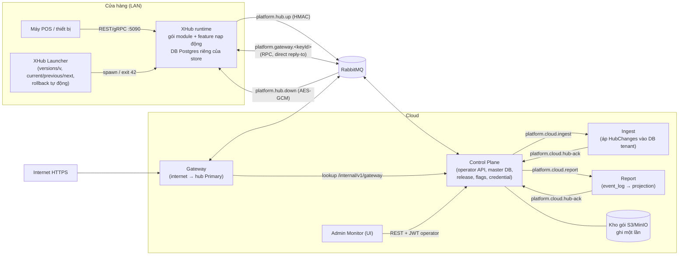
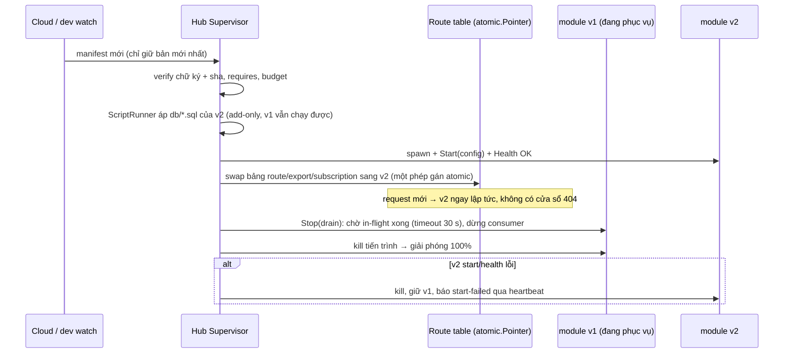

# Kế Hoạch Chuyển Đổi Kiến Trúc b-platform (.NET) Sang Go: XHub · CloudAPI · Gateway · Control Plane UI

> Phạm vi: **chỉ kiến trúc**. Nghiệp vụ (Catalog, Sales, Payment, Loyalty…) bỏ qua; giữ 1–2 module mẫu để chứng minh nền tảng.
> Dự án tham chiếu: `/Users/raiden/Workspace/2026/b-platform` (chỉ đọc). Chưa code — tài liệu này là plan để duyệt.

---

## 1. Hiểu dự án tham chiếu (b-platform)

### 1.1. Mô hình tổng thể

**Cửa hàng là đơn vị của mọi thứ.** Mỗi cửa hàng chạy một **XHub** (nguồn sự thật, bán được khi mất mạng, nghiệp vụ nạp
động dưới dạng gói có version). **Cloud** quản lý tenant/store/release, giữ **bản sao** dữ liệu từng cửa hàng và cập nhật hub
từ xa (OTA). **Gateway** đưa API của hub ra internet mà hub **không mở cổng vào** (hub chỉ nói ra — outbound only).



### 1.2. Ba trụ cột cần chuyển đổi

| Trụ cột | Vai trò | Thành phần chính trong ref |
|---|---|---|
| **XHub** | Runtime cửa hàng: nạp gói động, hot reload, outbox/inbox, change capture, đồng bộ lên cloud, OTA qua Launcher | `Platform.XHub.{Abstractions,Runtime,Packages,Link,Sync,Health,Console,Gateway}`, host `Platform.XHub`, `Platform.XHub.Launcher`, SDK `Platform.Modularity` |
| **CloudAPI** | Control Plane (tenant, store, DB server, credential, package, release, feature flag, audit, console) + Ingest + Report; chạy **chung một tiến trình** hoặc **tách service** (`Cloud:Mode=split`) | `ControlPlane.{Domain,Application,Infrastructure}`, `Ingest`, `Report`, `Platform.Cloud.Hosting`, hosts `CloudApi`/`IngestHost`/`ReportHost` |
| **Gateway** | Nhận HTTPS, định danh `tenant/store` (3 kiểu URL), tìm hub **Primary**, kiểm `x-hub-key`, niêm phong request (AES-GCM) rồi RPC qua RabbitMQ tới hub; hub chạy request qua chính pipeline HTTP nội bộ | `Platform.Gateway`, `Platform.Gateway.Contracts`, `Platform.XHub.Gateway` |

### 1.3. Cơ chế cốt lõi (đã đối chiếu mã)

**Gói (package)**
- Zip tất định `<key>-<ver>.zip` gồm: bản publish, `platform.json` (trường tác giả + trường sinh lúc pack: `requires`, `routes`, `schema`, `scripts`, `extensionPoints`, `subscribes`…), `db/*.sql`.
- Ba loại `kind`: `module`, `feature` (gói riêng, gắn vào module chủ), `hub` (chính runtime XHub — OTA runtime cũng là một gói).
- Kho gói **ghi một lần** (S3 `IfNoneMatch="*"`; cùng `key@version` mà khác sha ⇒ `package-immutable`). Hub chỉ kiểm sha256 theo manifest. **Chưa có chữ ký số** (BACKLOG S2).
- `requires` (`^x.y.z` / `>=a <b`) được kiểm ở 3 nơi: khi đóng gói, khi lập release (`ReleasePlanner`), và trên hub (`ModuleRequirements`).

**Release & manifest**
- Release ghim **version gói theo tenant**; cờ feature ghim **theo store** (cờ store đè cờ tenant).
- `ReleasePlanner.preview` kiểm: requires, route-conflict, extension-conflict, yanked, rollback-unsafe (DB010), migration-edited…
- Áp release: chạy script trên DB tenant và DB report trước, rồi đẩy `HubManifestPushed` tới mọi hub.
- Release chỉ được coi là "applied" khi heartbeat của hub báo `ledger digest` và gói đang chạy khớp (rollout không lưu trạng thái, suy ra từ heartbeat).
- Có lease theo instance (`ApplyingUntil`, gia hạn 30 s), cùng các thao tác resume / abandon / rollback.

**Hot reload trên hub** (`HubSupervisor`)
- Mọi manifest (welcome, push, hello) dồn vào một channel; vòng apply **chỉ giữ manifest mới nhất** và chạy tuần tự.
- Fingerprint `key@version:sha` không đổi ⇒ bỏ qua gói đó. Riêng đổi cờ thì chỉ swap `FeatureSnapshot`, không đụng gói nào.
- Thay gói: nạp ALC mới và chạy script mới **trong khi bản cũ vẫn phục vụ**, sau đó dừng bản cũ (kéo theo các gói phụ thuộc), start bản mới, và nạp lại bản cũ nếu start lỗi.
- **Điểm yếu đo được:** không drain request đang chạy; route trả 404 trong khoảng giữa stop và start; ALC có thể rò rỉ (`unload-leak`); settings **không** cập nhật nóng (chỉ áp khi restart gói); Contracts đổi ⇒ phải restart cả tiến trình (exit 42).

**OTA runtime** (Launcher)
- Thư mục `versions/<v>`, file `current|previous|next`, `bad/<v>`, `retry/<v>`.
- Hub tải gói `xhub`, giải nén, ghi `next`, rồi `exit 42`; Launcher chuyển sang version đó.
- Sau khi chuyển, chết trong 90 s đầu ⇒ `MarkBad` rồi quay về version trước. Riêng mã thoát 75 (lỗi DB tạm thời) ⇒ `retry` với backoff.
- **Lỗ hổng:**
  - không ai đọc `RuntimeRetry` (cloud gửi xuống nhưng hub bỏ qua);
  - `retry/<v>` không được kiểm;
  - nhánh rollback chưa từng được chạy thử;
  - cùng version thì Launcher không làm mới runtime.

**Dữ liệu**
- Một DB mỗi store trên hub, một DB `tenant_<code>` (chứa mọi store, mọi row có `store_id`) và một DB `tenant_<code>_report` trên cloud.
- **Tách module bằng schema**: `platform`, `biz_<module>`, `ft_<module>__<feature>`, `report`.
- Mỗi schema có ba role `<s>_owner` (chạy script), `<s>_rw`, `<s>_ro`.
- Script chỉ được thêm (cấm DROP/RENAME). Sổ ghi script đã chạy là `platform.migrations` (lưu checksum, đánh dấu rollback-unsafe).
- Trigger capture ghi mọi thay đổi vào `platform.changes`, theo thứ tự commit. `ChangeShipper` gửi theo lô 500 và chỉ xoá khi nhận ack.
- Ingest giữ cursor `(store, epoch, last_seq)`, idempotent theo seq, và `retired_epochs`.

**Bảo mật**
- Hub token `phub1.<base64url JSON>` chứa thông tin RabbitMQ + `keyId` + `busKey` 32 byte.
- Bus key dùng cho ba việc: HMAC chiều lên, AES-GCM chiều xuống, và HKDF ra `x-hub-key` (device key, dùng cho gateway/LAN).
- Operator dùng JWT HS256 với 3 cấp Support < Admin < Root, refresh token xoay vòng 7 ngày.

**Giữa các module**
- Gọi đồng bộ: `IModuleClient` RPC; caller phải khai `uses`, target phải khai `export`.
- Sự kiện: `IModuleEvents` ghi vào outbox **cùng transaction**, `OutboxDispatcher` giao tới inbox (khử trùng), có cursor và dead-letter.
- Extension point `[ExtensionPoint(Single|Multiple)]` do feature hiện thực.

### 1.4. Những gì ref chưa làm xong — Go **phải** giải quyết từ đầu

| Gap trong ref | Hướng xử lý trong bản Go |
|---|---|
| Hot reload không drain, có cửa sổ 404, ALC rò rỉ | Module là **tiến trình riêng** ⇒ blue/green: start bản mới song song, đổi bảng route bằng `atomic.Pointer`, drain bản cũ, kill. Không rò rỉ bộ nhớ (tiến trình chết là sạch) |
| Settings không nóng | RPC `ApplyConfig(snapshot)` đẩy vào module đang chạy; module giữ config trong `atomic.Pointer` |
| Đổi Contracts ⇒ restart toàn hub | Contracts là **protobuf trên wire** chứ không phải assembly dùng chung ⇒ đổi contract chỉ restart các module liên quan |
| Không ký gói | Ký **ed25519** (`manifest.sig`); hub kiểm public key được ghim trong runtime |
| RuntimeRetry / `retry/<v>` không ai đọc; rollback chưa chạy thử | Launcher và Updater đọc đủ; có test tích hợp OTA 2 version (lên, xuống, crash ⇒ rollback) |
| Make-primary không vô hiệu cache gateway (trễ 10 s) | Phát `credential-changed` cho cả rotate, revoke **và** make-primary |
| Hub console cần đúng 1 instance CloudApi | Chờ kết quả qua reply queue riêng của từng instance (direct reply-to), không dùng map trong bộ nhớ |
| Repo không có test | Giữ quy ước hiện tại của aegis: unit test + integration test (Postgres/PgBouncer/RabbitMQ thật) |

---

## 2. Đối chiếu với aegis-kernel hiện tại

| Đã có trong aegis | Dùng lại thế nào |
|---|---|
| Kernel + `hashicorp/go-plugin` (mỗi module một tiến trình), `ModuleManager`, `ShutdownAll` 2 pha | **Lõi của XHub runtime.** Đổi net/rpc sang **gRPC** (go-plugin hỗ trợ), vì gRPC + protobuf mới cho phép module và runtime lệch version |
| `sdk.ModuleApp`, CQRS `FeatureDispatcher` (override/extend theo cờ) | Thành SDK module (`sdk/`), bổ sung `Feature`, `ExtensionPoint`, `ModuleClient`, `ModuleEvents` |
| `ConnectionManager` (idle TTL, LRU, rebind), PgBouncer transaction pooling | Một pool mỗi DB (không còn pool theo module); schema chọn bằng `SET LOCAL search_path` mỗi transaction |
| `dbaudit`: trigger → outbox cùng transaction → relay → bus, sweep 30 s | Tiến hoá thành **change capture** `platform.changes` (đồng bộ lên cloud). Audit trở thành **một consumer** của dòng thay đổi này |
| Module `audit` (3 lớp, hash chain) | Giữ làm module nền tảng (audit operator + nghiệp vụ) |
| Kernel Event Bus (poll + ack, retry, dead-letter, cycle guard, drain) | Thành `OutboxDispatcher` nội bộ hub (giữa các module), chuyển sang dựa trên outbox/inbox trong DB thay vì bộ nhớ |
| JWT HS256, gateway nội bộ (actor headers, trusted proxy, call chain 508) | Thành **HTTP mặt LAN của hub** + middleware dùng chung với Gateway cloud |
| Control Plane (Postgres `cp_db`, provision tenant, migrator) + UI React/Vite | Mở rộng thành Control Plane đầy đủ: store, credential, package, release, flag, rollout, fleet, console |
| **DB riêng cho mỗi tenant × module** (`auth_<t>`, `parties_<t>`, `audit_<t>`) | **Bỏ.** Chuyển sang 1 DB mỗi store (hub) / 1 DB mỗi tenant (cloud), **mỗi module một schema** (§4) |

---

### 2.1. Chẩn đoán `core/` (rà soát 2026-11-02, sau Bước 1)

`core` hiện là **một tiến trình kiêm hai vai**: Control Plane (cloud) và runtime chạy module (hub). Kiến trúc đích tách hai vai này:
- phần hub (`loader`, `transport`, `bus`, routing, `changefeed`) → `framework/hub/*`, binary `cmd/xhub`;
- phần cloud (`controlplane`) → `framework/cloud/controlplane`, binary `cmd/cloudapi`.

Khoảng 1/3 code giữ được nguyên hoặc gần nguyên; phần còn lại là khung "nạp module một lần lúc khởi động", phải viết lại để có hot reload, OTA và manifest.

| Package | Dòng | Kết luận | Lý do | Làm ở |
|---|---|---|---|---|
| `changefeed` | 668 | **Giữ** | Đúng mô hình đích. Chuyển sang `framework/hub/sync`, thêm consumer `@cloud`. | Bước 4 |
| `gateway`: `auth.go`, `callchain.go`, `clientip.go` | ~300 | **Giữ, tách ra** | Kiểm JWT, chặn gọi vòng (508), IP qua proxy tin cậy: độc lập, có test. Thành middleware dùng chung cho HTTP mặt LAN của hub và Gateway cloud. | Bước 3, 7 |
| `bus` | 482 | **Giữ giao/retry/cycle guard, bỏ phần poll** | `deliver` (retry, backoff) và cycle guard dùng lại cho dispatcher. Outbox hiện **nằm trong bộ nhớ** module (`sdk/outbox.go`): module crash là mất sự kiện. Chuyển sang `<schema>.outbox` trong DB (có từ Bước 1) + dispatcher đọc theo cursor. | Bước 3 |
| `contract` | 148 | **Sửa nhiều, giữ khái niệm** | Giữ header, `AuditTable`, `Event`. Bỏ: `MicroModule` qua net/rpc; `InvocationRequest` (body đọc trọn vào bộ nhớ; query `map[string]string` mất giá trị lặp); `ModuleInitConfig.Tenants` (gửi DSN có mật khẩu của mọi tenant cho mọi module); `TenantRequestContext.ConnectionString` theo từng request. Thay bằng `module.proto`. | Bước 3 |
| `transport` | 163 | **Thay** | net/rpc: `Execute`, `Initialize`, `GetRoutes` bỏ qua `ctx` (không huỷ/timeout được), chỉ chạy khi hub và module cùng version. Thay bằng go-plugin gRPC. | Bước 3 |
| `loader` | 195 | **Viết lại thành Supervisor** | Quét `bin/modules` một lần lúc khởi động; không version, không kiểm chữ ký; không theo dõi tiến trình (module crash vẫn nằm trong bảng, request tới nó lỗi mãi); không thay được khi đang chạy; `Environment: "production"` cứng. | Bước 3 |
| `gateway`: routing (`Handler()`) | ~400 | **Viết lại** | Route gắn vào chi **một lần** nên không hot reload được. Mỗi request 2–4 truy vấn tới `cp_db` (resolve tenant, lặp lại cho cờ feature); hub ở cửa hàng không có `cp_db`. Thay bằng bảng route trong `atomic.Pointer` + cờ từ manifest trong bộ nhớ. | Bước 3 |
| `feature` | 27 | **Bỏ** | Bọc quanh `ResolveTenantRequestContext`, mỗi lần kiểm là một truy vấn DB. Thay bằng `FeatureSnapshot` từ manifest. | Bước 3 |
| `controlplane` | 1 290 | **Tách đôi, phần lớn viết lại** | Xem bên dưới. | Bước 2, 5 |

**`controlplane`**, vấn đề lớn nhất:
1. **Hai schema master song song.** `initSchema` tự tạo `cp_users`, `cp_sessions`, `cp_tenants`, `cp_tenant_modules`, trong khi `db/master` đã có `operator`, `tenant`, `store`, `credential`, `release`, `feature_flag`, `audit`. Phải bỏ bộ `cp_*` để không có hai nguồn dữ liệu.
2. **Trộn vai trò trong một `Store`**: đăng nhập operator (token session trong DB, `SUPER_ADMIN` cứng), danh bạ tenant, tạo/xoá DB, pooler, migration. Tách Domain / Application / Infrastructure.
3. **Import trực tiếp `modules/*/db`** để lấy script: vi phạm ranh giới framework–nghiệp vụ, hiện chưa bị gate bắt (gate chỉ kiểm `framework`, `db`, `cmd`).
4. **Seed cứng**: `admin/admin123`, mã MFA `654321`, cờ `enable_global_audit`.

Giữ: `pooler.go` (chọn node PgBouncer theo hash tenant, DSN admin/runtime, có test), `tenant_database.go` (provision của Bước 1), bộ endpoint `/api/cp/*` làm khung tham khảo cho REST API mới.

Trong lúc chuyển, `core` và `launcher` vẫn chạy như hiện tại: thay từng phần, không phá hệ thống đang có.

## 3. Kiến trúc đích (Go)

### 3.1. Cấu trúc repo

```
aegis/
├── go.work                        # framework + sdk + từng module mẫu là module Go riêng
├── cmd/                           # chỉ ráp (giống src/Hosts)
│   ├── cloudapi/                  # control plane (+ ingest + report khi mode=single)
│   ├── ingest/                    # mode=split
│   ├── report/                    # mode=split
│   ├── gateway/                   # internet → hub
│   ├── xhub/                      # runtime cửa hàng
│   ├── xhub-launcher/             # OTA, đổi version, rollback
│   └── platform/                  # CLI: pack, push, sign, db new|lint|plan|apply, dev watch|flag, release show
├── framework/
│   ├── core/
│   │   ├── cqrs/                  # mediator, ICommand/IQuery, pipeline (từ sdk/cqrs hiện tại)
│   │   ├── data/                  # scriptrunner, lint (DBxxx), ledger, conformance, pgx pool mỗi DB, `SET LOCAL search_path` theo schema
│   │   ├── bus/                   # RabbitMQ (amqp091), topic, group, protobuf codec, outbox cloud
│   │   ├── wire/                  # proto: hub.v1 (Hello/Welcome/Changes/…), gateway.v1, module.v1
│   │   ├── security/              # hub token, HMAC/AES-GCM envelope, HKDF device key, ed25519, secretbox (KEK)
│   │   ├── packaging/             # descriptor platform.json, verify, deterministic zip, version range, manifest
│   │   └── health/                # /health/live|ready, check DB/bus
│   ├── hub/
│   │   ├── runtime/               # supervisor, process host (go-plugin gRPC), route table, extension registry, feature snapshot
│   │   ├── packages/              # cache, fetcher, updater (OTA runtime)
│   │   ├── link/                  # bus hub↔cloud, pairing, inbound handlers
│   │   ├── sync/                  # change shipper, snapshot/resync, epoch
│   │   ├── messaging/             # outbox dispatcher, inbox, module RPC broker, dead-letter
│   │   ├── health/                # heartbeat, metrics, run ledger, outage ledger
│   │   ├── console/               # hub half của DB console (transaction read-only)
│   │   └── gwchannel/             # consumer platform.gateway.<keyId> → loopback HTTP
│   └── cloud/
│       ├── controlplane/{domain,app,infra}
│       ├── ingest/{app,infra}     # change applier, cursor, ack
│       ├── report/{app,infra}     # event_log, projection, retention
│       └── hosting/               # mode single|split, internal API + service token
├── sdk/                           # module Go riêng (go.mod riêng, semver) — THỨ DUY NHẤT gói nghiệp vụ được import
│   ├── module.go                  # Module, Feature, ExtensionPoint, Serve()
│   ├── data/                      # ReadDB/WriteDB (UoW, outbox cùng tx), không có chuỗi kết nối
│   ├── client.go, events.go       # ModuleClient (uses/export), ModuleEvents
│   └── contracts/                 # sinh code từ .proto của từng module (*.contracts)
├── modules/                       # gói mẫu: identity (auth), parties, audit — mỗi module: domain/app/infra/api/db/platform.json
│   └── <m>/features/<f>/          # feature là gói riêng
├── db/platform/, db/master/       # script nền tảng (giống ref)
├── web/                           # Control Plane UI
└── deploy/, docker-compose.yml
```

Luật phụ thuộc (kiểm bằng `go list -deps` trong CI gate):
- `framework/**` và `cmd/xhub` **không import** `modules/**`.
- `modules/**` chỉ import `sdk/**` và contracts của module mà nó khai `uses`.

### 3.2. Mô hình gói & tiến trình (thay cho AssemblyLoadContext)

Go không unload được thư viện nạp bằng `plugin`, vì vậy **mỗi gói là một binary riêng chạy thành tiến trình con của hub** (aegis đã làm kiểu này):

```
<key>-<ver>.zip
├── platform.json          # tác giả + trường sinh (requires, routes, schema, scripts, exports, subscribes, extensionPoints, implements)
├── bin/<os>_<arch>/<key>  # nhiều kiến trúc trong một gói (linux_amd64, linux_arm64, darwin_arm64 cho dev)
├── contracts/*.proto      # API công khai (module), nguồn sinh code cho consumer
├── db/*.sql               # script schema của gói (add-only, lint DBxxx)
└── manifest.sig           # ed25519 trên sha256 của mọi file
```

| Giao tiếp | Cơ chế |
|---|---|
| Hub → module | go-plugin **gRPC**: `Describe`, `Start(config)`, `ApplyConfig(flags, settings)`, `Serve(HTTP frame)`, `HandleEvent`, `Call(method)`, `Health`, `Stop(drain)` |
| HTTP vào module | Hub giữ route table; request đi qua gRPC stream (header + body chunk) ⇒ hỗ trợ cả body lớn và streaming, không bị giới hạn buffer như ref |
| Module ↔ module | `ModuleClient.Call(module, method, proto)`: request qua hub broker, hub kiểm `uses`/`export` |
| Sự kiện | `ModuleEvents.Publish` ghi vào `<schema>.outbox` trong cùng transaction; hub dispatcher giao `HandleEvent`; bên nhận ghi inbox trong UoW của mình (khử trùng) |
| DB | Hub cấp cho module `WriteDB/ReadDB` đã gắn **schema của module** (`SET LOCAL search_path` mỗi transaction). Không có role theo schema; module không tự chọn schema, SDK không lộ chuỗi kết nối |

### 3.3. Hot reload "ngay lập tức" (zero-downtime)



Các quy tắc:
- **Đổi cờ / settings**: chỉ swap `FeatureSnapshot` và gọi `ApplyConfig` cho gói bị ảnh hưởng, không restart gì. Mục tiêu dưới 100 ms từ lúc cloud bấm tới lúc hub áp.
- **Phụ thuộc** (`uses`): v2 của provider lên trước; consumer giữ kết nối tới broker của hub, không giữ tới tiến trình provider ⇒ **không phải restart consumer** (khác ref).
- **Đổi contract** không tương thích: `requires` bắt từ lúc lập release; hub chỉ restart các consumer có `requires` đổi.
- **Thứ tự**: một channel duy nhất, chỉ giữ manifest mới nhất, apply tuần tự (giống ref); mỗi gói được thay ở bước riêng.
- **Dev**: `platform dev watch <dir>` build lại binary, rồi hub (Development) nhận qua thư mục dev và chạy cùng đường blue/green. Thời gian mục tiêu ≈ thời gian `go build` + ~200 ms.

### 3.4. OTA runtime (XHub Launcher)

Giữ nguyên mô hình đã chứng minh của ref, và vá các lỗ hổng:

```
$XHUB_HOME/
├── versions/<v>/xhub      # binary runtime (gói kind=hub, đã kiểm chữ ký)
├── current  previous  next
├── bad/<v>  retry/<v>     # retry có hạn backoff, Updater PHẢI đọc
├── hub.token (0600)       # sống qua OTA
└── cache/modules/<key>/<ver>/<sha12>/   (+ .ready)
```

| Sự kiện | Launcher |
|---|---|
| exit 42 + `next` hợp lệ | previous=current, current=next, bắt đầu **probation 90 s** |
| Chết trong probation, exit 75 (DB tạm thời) | `retry/<v>` (5 phút → 1 giờ), quay về previous |
| Chết trong probation, mã khác | `bad/<v>`, quay về previous, heartbeat báo `runtime-blocked` |
| Crash ngoài probation | restart cùng version, backoff `min(60s, 2^n)` |
| Cloud gửi `RuntimeRetry` | xoá `bad/<v>` (lỗ hổng của ref) |

Thêm so với ref:
- Updater **áp trước** script `db/platform` của version mới, khi version cũ vẫn chạy. Việc này an toàn vì script là add-only.
- Ghi `next` bằng thao tác đổi tên file nguyên tử.
- Runtime chỉ chấp nhận gói `hub` có chữ ký hợp lệ.
- Launcher là binary nhỏ, không có mạng, gần như không bao giờ đổi. Nó tự cập nhật theo cơ chế riêng (thay file rồi re-exec), chỉ khi có bản launcher mới.

### 3.5. Dữ liệu: **tách module bằng schema** (thay cho DB riêng mỗi module)

| DB | Schema | Ghi bởi |
|---|---|---|
| `master` (cloud) | `public` (operator, tenant, store, db_server, credential, hub, hub_incident, hub_metrics, package, release, feature_flag, audit), `outbox` cloud | Control Plane |
| `tenant_<code>` (cloud) | `platform` + `biz_<module>` + `ft_<module>__<feature>` của **mọi store** (mọi bảng có `store_id`) | **Chỉ Ingest** |
| `tenant_<code>_report` (cloud) | `report` (`event_log`, `projection_row`, `projection_checkpoint`, `event_cursors`) | Report |
| `hub` (mỗi store, ở cửa hàng) | `platform` (settings, changes, cursors, dispatch_cursors, dead_letters, migrations, devices, metrics) + `biz_*` + `ft_*` + `report` + `outbox`/`inbox` mỗi schema | Runtime + module |

Quy tắc schema (theo ref, viết lại dạng Go):
- Một thư mục `db/` tương ứng một chủ sở hữu và một schema. Tên file `yyyyMMddHHmm_<slug>.sql`, sinh bằng `platform db new`.
- Lint (DBxxx) chạy ở `db lint`, `pack`, lúc đăng ký gói và trên hub trước khi chạy:
  - chỉ thêm, không DROP/RENAME/đổi kiểu, không DML vào bảng đồng bộ;
  - bảng mới bắt buộc `store_id uuid NOT NULL DEFAULT platform.store_id()`;
  - mọi UNIQUE phải chứa `store_id`;
  - không ghi tên schema trong script, không GRANT/SET/DO/FUNCTION/TRIGGER.
- Mỗi file chạy trong một transaction có advisory lock, `lock_timeout 5s`, `SET LOCAL search_path=<schema>` (không `SET ROLE`).
- Ghi sổ `platform.migrations` gồm checksum và cờ `rollback_unsafe` (marker `-- platform:allow DB010`).

**Không dùng role theo schema (khác ref, đã chốt).** Ref tạo `<s>_owner/_rw/_ro` cho mỗi schema; bản Go **bỏ hẳn**:
- Một login ứng dụng cho mỗi DB (`aegis_app`) và một login cho migrator (`aegis_migrator`, chỉ dùng DSN trực tiếp `:5432`). PgBouncer chỉ có **một pool mỗi DB** (số pool = số DB, không nhân theo số module).
- Module được tách bằng **`search_path`**, không phải bằng quyền: SDK mở mỗi transaction bằng `SET LOCAL search_path = <schema>, platform`. Lệnh này gửi chung batch với `BEGIN` nên không thêm round-trip, và an toàn với transaction pooling vì `SET LOCAL` hết hiệu lực khi transaction kết thúc. Code module chỉ dùng tên bảng không kèm schema.
- Ranh giới giữa module không còn do Postgres chặn, nên được giữ bằng các lớp khác:
  - lint script: không ghi tên schema, không GRANT/SET;
  - gate trong SDK: module chỉ nhận `WriteDB/ReadDB` đã gắn schema của chính nó, không có API mở kết nối thô;
  - đóng gói: `PackageVerifier` từ chối gói import `pgx`/`database/sql` trực tiếp;
  - test conformance: so truy vấn sqlc của gói với schema của chính gói.
- Đọc chỉ-đọc dùng `SET LOCAL transaction_read_only = on` trong cùng batch.
- Trên hub (một DB, ít tải) có thể bỏ PgBouncer và dùng pgx pool trực tiếp; vẫn một pool cho cả DB.
- Đánh đổi: một module có lỗi hoặc bị cố ý viết sai vẫn có thể ghi sang schema khác bằng tên đầy đủ. Chấp nhận được vì gói đều qua verify, được ký, và do mình phát hành.

**Change capture → đồng bộ cloud (tiến hoá từ `dbaudit`)**
- `platform.track_schema(s)` gắn trigger capture vào mọi bảng không thuộc `localTables`. Trigger ghi `platform.changes(seq theo thứ tự commit, schema, table, op, row_json, txid, context)`.
- Ngữ cảnh actor/request đi kèm qua `set_config('aegis.ctx', …, true)` (đã có).
- `ChangeShipper` (chỉ hub Primary) gửi `HubChanges` theo lô 500 và xoá khi nhận ack đúng epoch.
- Ingest: một transaction, `session_replication_role=replica`, cursor `(store, epoch, last_seq)`, `retired_epochs`, kiểm shape theo `pg_catalog`. Cột lạ ⇒ `pending` (không ack); vi phạm ràng buộc ⇒ `ingest-blocked`.
- Audit: module `audit` nhận dòng thay đổi qua dispatcher trên hub, hoặc nhận bản ingest trên cloud. Không cần relay riêng như `dbaudit` hiện tại.

### 3.6. Bus và wire

- **RabbitMQ** (`amqp091-go`) với payload **protobuf**. Topic giữ như ref: `platform.hub.up`, `platform.hub.down`, `platform.cloud.ingest`, `platform.cloud.report`, `platform.cloud.hub-ack`, `platform.cloud.credential-changed`, `platform.gateway.<keyId>`.
- `HubEnvelope{message_id, key_id, payload Any, sealed, nonce, signature, sent_at}`. Chiều lên ký HMAC-SHA256, lệch đồng hồ tối đa 10 phút; chiều xuống mã hoá AES-256-GCM với AAD `id\nkeyId\nsentAt`.
- **Cải tiến:** mỗi hub một **user RabbitMQ riêng** (ref dùng chung: S1) với quyền chỉ trên `platform.hub.up` (publish) và queue `platform.hub.down.<keyId>` (consume). Như vậy hub không còn nhận message xuống của hub khác.
- Cloud outbox: CP ghi message vào bảng outbox của master trong cùng transaction rồi publish sau commit. Đây là thay thế cho CAP, tự viết trên nền outbox đã có trong aegis.

### 3.7. CloudAPI (single | split)

- `cmd/cloudapi` có `CLOUD_MODE=single|split`.
  - `single`: ingest và report chạy in-process qua adapter (giống `InProcessBus` của ref).
  - `split`: CP gọi `ingest`/`report` qua internal API có `X-Service-Token`.
- Gateway lookup: `GET /internal/v1/gateway/{tenant}/{store}` với `X-Gateway-Token`. Endpoint này chỉ trả **khoá dẫn xuất** (HKDF seal key + device key), không bao giờ trả bus key.
- Domain giữ đúng ranh giới của ref: Operators, Tenancy (Tenant, Store, DatabaseServer), Hubs (Credential Primary/Standby, Hub, Incident), Releases (Package, Release, FeatureFlag), Auditing.
- Release:
  - `Planner.Preview`, rồi `Runner.Apply` có lease theo `INSTANCE_ID`, gồm script tenant → script report → `ManifestPublisher`;
  - rollout suy ra từ heartbeat;
  - có resume, abandon, rollback.
- Tenant provisioning:
  - chọn DB server có ít tenant nhất;
  - tạo `tenant_<code>` và `tenant_<code>_report`;
  - áp script `platform`;
  - tạo store gốc + credential `Default hub`;
  - tạo release #1 với các gói `install: default`;
  - trả **hub token một lần**.

### 3.8. Gateway (Go)

Pipeline giữ đúng thứ tự của ref:
1. Resolve URL theo một trong ba kiểu: `{store}.{tenant}.{base}`, `{tenant}.{base}/{store}` (khuyên dùng) và `{base}/{tenant}/{store}`.
2. Lọc path: chặn `..`, `//`, `%2f`, ký tự điều khiển; luôn 404 với `/hub`, `/health`, `/swagger`; áp `AllowedPrefixes`.
3. Rate limit theo store (token bucket, mặc định 50/s, burst 100).
4. `HubDirectory`: cache 10 s, vô hiệu khi có `credential-changed`.
5. So `x-hub-key` bằng constant-time compare, và **không chuyển tiếp** key này.
6. Kiểm online: `lastSeen` quá 45 s ⇒ 503 `hub-offline`.
7. Niêm phong AES-GCM, rồi publish với `mandatory` + `amq.rabbitmq.reply-to` + `Expiration`. Không có queue ⇒ 503 ngay; quá hạn ⇒ 504.

Phía hub (`gwchannel`):
- Queue exclusive `platform.gateway.<keyId>` (TTL 30 s, max 1000, reject-publish), prefetch 16.
- Mở niêm phong, chống replay, kiểm deadline, rồi gọi **loopback** vào chính HTTP server của hub, để LAN và internet đi chung route và middleware.

Mở rộng so với ref: cho phép body lớn hơn và SSE bằng cách chia frame (`seq`, `eof`) trên reply-to. Để ở giai đoạn sau; giai đoạn đầu giữ giới hạn 1 MiB / 4 MiB như ref.

---

## 4. Control Plane UI

Nâng cấp `web/` hiện tại (React 19 + Vite, một file `App.tsx` 2 100 dòng) thành ứng dụng có cấu trúc. **Giữ Vite**, vì không cần SSR như Next của ref.
- Thư viện UI: Tailwind 4 + shadcn/ui (Radix), lucide.
- Router và dữ liệu: TanStack Router + TanStack Query (polling dừng khi tab ẩn, giống `usePoll` của ref).
- Thành phần khác: TanStack Table, Recharts, CodeMirror 6 (SQL), xyflow + elkjs (ERD).

**Nền**
- `apiClient` bóc envelope `{success, data, errorCode}`.
- JWT operator, refresh chủ động khi còn dưới 90 s, single-flight bằng `navigator.locks`, đồng bộ giữa các tab.
- Ẩn hoặc vô hiệu nút ghi theo cấp operator (`Support` chỉ đọc).
- Read-your-writes qua header LSN (giai đoạn sau, khi có replica).

| Khu | Trang | Chức năng chính |
|---|---|---|
| Home | `/login` | Lần đầu: tạo operator Root (`setup/status` → `setup/initialize`); đổi API endpoint |
| | `/home` | Tile: tenant, store, hub online/tổng, cần chú ý, store chưa có hub, runtime mới nhất; bảng "Needs attention" |
| Tenant | `/tenants` | Tạo tenant (code, tên, DB server hoặc để trống = ít tải nhất) ⇒ **hiện hub token một lần** + hướng dẫn ghép cặp; đổi tên; provision lại |
| | `/stores`, `/stores/:id` | Store: hub Primary/Standby, sức khoẻ, Make primary; Online access (3 URL, key, curl); profile; "chạy gì / mong đợi gì"; sổ script; credential (xoay token, thu hồi, thêm hub standby); resync; duyệt bản sao dữ liệu trên cloud |
| | `/features` | Ma trận store × feature; editor: bật/tắt, time window, form settings sinh từ `settingsDefaults`; `validateOnly` rồi lưu với `expectedRevision`; Inherit; tag drift |
| | `/migrations` | Ma trận gói × {DB tenant, DB report, từng hub}: pending/edited/failed/ahead; trạng thái ingest từng store |
| | `/db-servers` | Danh sách, thêm server (Root, mật khẩu mã hoá bằng KEK) |
| Hub | `/hubs` | **Fleet trực tiếp**: tile trạng thái (upToDate/updating/outOfSync/failed/offline) làm filter, tìm/sort/phân trang trên URL, gửi lại release, resync hàng loạt |
| | `/hubs/:id` | Chẩn đoán (checks + phạm vi sự cố), gói đang chạy + lý do cờ tắt, extension bindings, metrics (cpu, mem, disk, db latency, http errors, sync pending), sự cố, thiết bị, Retry runtime |
| | `/releases` | Đang chạy + tiến độ rollout; **soạn release**: chọn runtime, ghim version gói → **Check** (preview: thay đổi gói, issue cần xác nhận, script theo đích) → **Apply**; lịch sử với Abandon/Resume/**Roll back to this**; deploy-info |
| | `/packages` | Nhóm gói (hub, module, feature lồng dưới module); chi tiết version: requires, routes, schema, scripts, chữ ký; Yank/Publish; Import (Root) |
| Platform | `/connection` | Endpoint, health, token đang dùng, đổi mật khẩu |
| | `/database` | Console chỉ đọc: nguồn master (Root) / tenant / hub (qua bus); tab SQL, Data, Builder (không SQL), Diagram (ERD) |
| Observe | `/audit` | Audit operator (actor, action, subject, lọc) + liên kết sang module audit (hash chain, verify) |

Hướng nâng cấp so với ref: ref chỉ polling. Bản Go thêm **SSE** `/api/v1/platform/events` cho fleet và rollout, vì CP đã nhận heartbeat nên đẩy thẳng xuống UI rẻ hơn polling. Polling vẫn giữ làm phương án dự phòng.

---

## 5. Các quyết định (đã chốt 2026-11-02)

| # | Câu hỏi | Quyết định |
|---|---|---|
| D1 | Mô hình nạp gói | **Tiến trình riêng + go-plugin gRPC** (đã có trong aegis, cho phép hot reload thật). Loại `plugin` của Go vì không unload được; WASM chưa đủ chín cho DB/HTTP |
| D2 | Bus | **RabbitMQ**, giữ đúng thiết kế ref (direct reply-to cho gateway, user riêng mỗi hub). NATS là phương án thay thế nếu muốn gọn hơn, nhưng sẽ lệch tài liệu ref |
| D3 | Truy cập dữ liệu (ref cấm SQL viết tay) | **sqlc** sinh code từ chính script `db/` (SQL kiểm lúc build, không dựng chuỗi SQL lúc chạy) + gate cấm `db.Exec(string)` ngoài `scriptrunner`/console. Ingest dùng builder động có kiểm shape từ `pg_catalog` |
| D4 | Role theo schema với PgBouncer | **Đã chốt: bỏ role.** Một login mỗi DB, tách module bằng `SET LOCAL search_path` + gate SDK/verify (§3.5) |
| D5 | Module hiện có (`auth`, `parties`, `audit`) | Giữ làm gói mẫu. Chuyển `auth` thành `identity` (người dùng **tại cửa hàng**), còn auth operator nằm trong Control Plane |
| D6 | Ký gói | ed25519, private key ở CI, public key ghim trong runtime hub và CP |
| D7 | UI | Vite + TanStack (không chuyển sang Next) |

---

## 6. Lộ trình (mỗi bước chạy được và kiểm được)

### Bước 0 — Khung và nền tảng dùng chung
- [x] Cấu trúc `framework/`, `cmd/`, `db/` (§3.1) + gate phụ thuộc (`framework/depgate_test.go`). `go.work` tách `sdk` thành module riêng để ở Bước 2, khi SDK mới thay `sdk/` hiện tại.
- [x] `framework/core/wire`: proto `hub.v1`, `gateway.v1`, `module.v1`; sinh code bằng `buf`.
- [x] `framework/core/security`: hub token `phub1.`, envelope HMAC/AES-GCM, HKDF device/gateway key, secretbox KEK, ed25519.
- [x] `framework/core/data`: ScriptRunner + ledger + lint DBxxx + `platform db new|lint|plan|apply`.
- [x] `db/platform` (provision_schema, track_schema, capture, outbox/inbox, cursors), `db/master` (operator, tenancy, hub, package, release, feature_flag, audit); nhúng qua package `db`.

### Bước 1 — Dữ liệu theo schema
- [x] Bỏ mô hình DB riêng mỗi module: DB `tenant_<id>` gồm `platform` + `biz_auth|biz_parties|biz_audit`, gắn store gốc (`platform.bind_store`); không role theo schema. SDK `sdk/tenantdb`: `Read/Write` mở transaction bằng `set_config('search_path', ..., true)`.
- [x] Viết lại migrations của `auth`, `parties`, `audit` thành `modules/<m>/db/*.sql` theo lint (bỏ dữ liệu seed: script cấm DML vào bảng đồng bộ; admin do Control Plane tạo khi provision). Đổi tên `auth` → `identity` để sang Bước 2 cùng lúc đóng gói.
- [x] Change capture `platform.changes` (+ `old_json`) và `platform.audit_events` dùng chung dãy seq theo thứ tự commit; **change feed trong Kernel** (`core/changefeed`) thay relay `dbaudit` trong từng module: gom theo transaction → `audit.Envelope`, che cột bí mật theo `AuditTables` của descriptor, cursor `@audit` trong `platform.dispatch_cursors`, dọn dòng đã giao. Test trực tiếp và qua PgBouncer; E2E trên kernel thật.

### Bước 2 — Đóng gói
- [ ] `platform.json` + trường sinh, `platform pack` (build đa kiến trúc, zip tất định, verify, ký), `platform push` (S3 ghi một lần).
- [ ] SDK: `Module`, `Feature`, `ExtensionPoint`, `ReadDB/WriteDB` (UoW + outbox), `ModuleClient`, `ModuleEvents`, `ApplyConfig`.
- [ ] Script module đi trong gói ⇒ gỡ import `modules/*` khỏi `core/controlplane`; mở rộng gate phụ thuộc cho cả `core/` (§2.1). Đổi tên `auth` → `identity`.

### Bước 3 — XHub runtime + hot reload
- [ ] Supervisor (channel giữ manifest mới nhất), process host go-plugin gRPC, route table `atomic.Pointer`, blue/green + drain.
- [ ] Outbox dispatcher / inbox / dead-letter / module RPC broker (uses/export).
- [ ] Feature snapshot + `ApplyConfig` nóng; `platform dev watch`.
- [ ] Thay `core/loader`, `core/transport`, `core/feature`, routing của `core/gateway` (§2.1). Chuyển `changefeed`, middleware JWT/call-chain/IP tin cậy và phần giao/retry của `core/bus` sang `framework/hub`; bỏ outbox trong bộ nhớ của SDK.
- [ ] Test: thay gói khi đang chịu tải 200 rps ⇒ **0 lỗi 5xx, 0 lỗi 404**; đổi cờ áp dưới 100 ms.

### Bước 4 — Liên kết hub ↔ cloud
- [ ] Pairing (`/hub/pair`, `hub.token` 0600), Hello/Welcome, heartbeat 15 s, metrics 30 s, run ledger/outage.
- [ ] Tải gói qua bus + cache `.ready`; ChangeShipper + epoch + snapshot/resync.

### Bước 5 — CloudAPI
- [ ] Control Plane domain/app/infra, operator auth (Root setup, JWT + refresh xoay vòng, 3 cấp), audit operator.
- [ ] Tenant provisioning, store, credential (rotate/revoke/primary), package registry, release planner/runner/lease/rollback, flag (revision), manifest builder, rollout.
- [ ] Ingest (ChangeApplier, cursor, pending/blocked, ack), Report (event_log, projection, retention).
- [ ] Mode `single|split` + internal API + service token.
- [ ] Thay `core/controlplane` (bỏ bảng `cp_*`, chạy trên `db/master`); giữ `pooler.go` và logic provision (§2.1).

### Bước 6 — OTA runtime
- [ ] `xhub-launcher` (versions, probation 90 s, bad/retry, RuntimeRetry), Updater áp script trước khi chuyển.
- [ ] Test tích hợp: v1→v2 thành công; v2 crash ⇒ rollback v1; exit 75 ⇒ retry; downgrade có script rollback-unsafe ⇒ cảnh báo.

### Bước 7 — Gateway
- [ ] `cmd/gateway` (3 kiểu URL, rate limit, directory cache + vô hiệu, x-hub-key, seal, direct reply-to), `gwchannel` trên hub + loopback.
- [ ] Test: hub tắt ⇒ 503 dưới 1 s; quá hạn ⇒ 504; replay bị bỏ; make-primary ⇒ route mới ngay.

### Bước 8 — Control Plane UI
- [ ] Khung (router, query, auth, layout, command palette), Home, Tenants/Stores/Token reveal.
- [ ] Fleet + Hub detail (SSE), Releases (preview/apply/rollback), Features matrix, Packages, Migrations.
- [ ] DB console, Audit, Connection.

### Bước 9 — Vận hành
- [ ] docker-compose: postgres, pgbouncer, rabbitmq, minio, db-migrate, cloudapi, gateway, ui, xhub + xhub-standby.
- [ ] Bật lại CI (đang tạm tắt) với service Postgres/RabbitMQ; tài liệu phục hồi thảm hoạ (kho gói ghi một lần là nguồn sự thật).

---

## 7. Ngoài phạm vi (giai đoạn này)
- Nghiệp vụ POS (Catalog, Sales, Payment, Loyalty), giao diện POS, gRPC cho máy POS.
- Failover tự động Primary/Standby và nhân bản dữ liệu sang Standby (ref cũng chưa làm).
- Report engine nâng cao (định nghĩa báo cáo dạng gói); giai đoạn đầu chỉ dựng khung event_log/projection.
